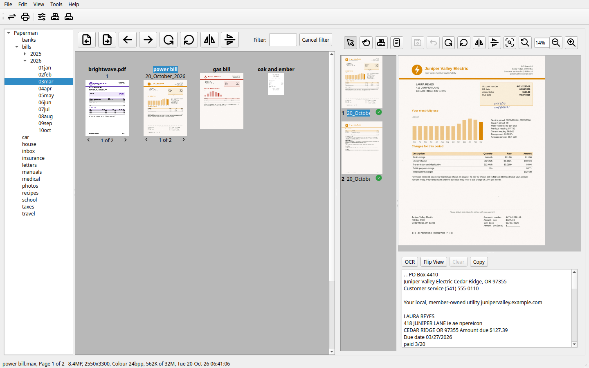
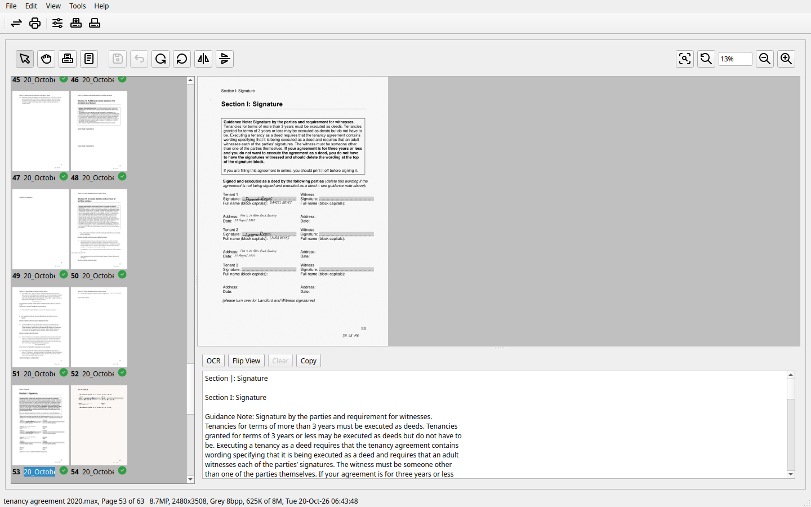
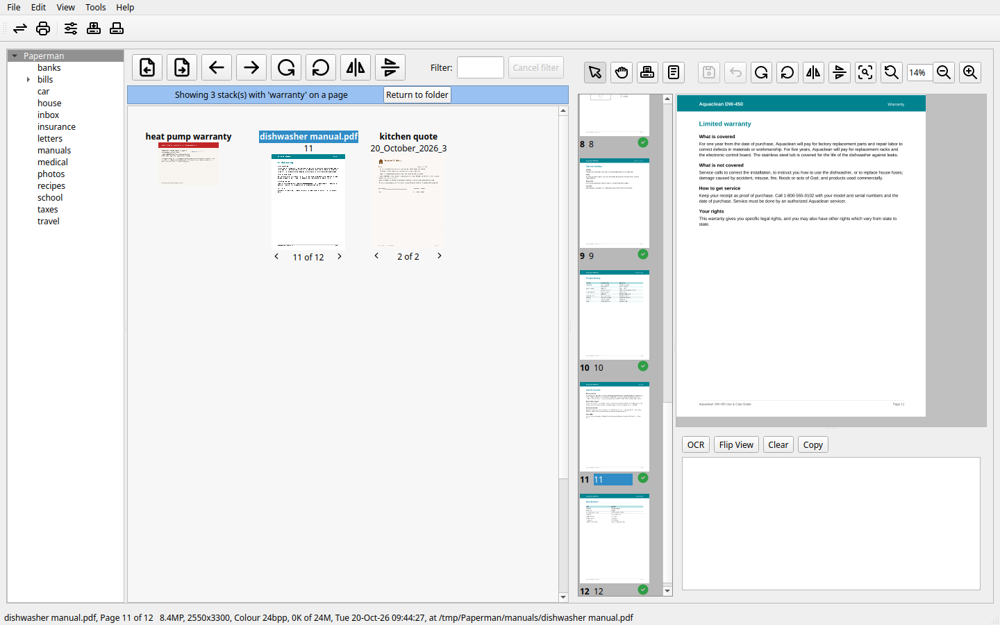
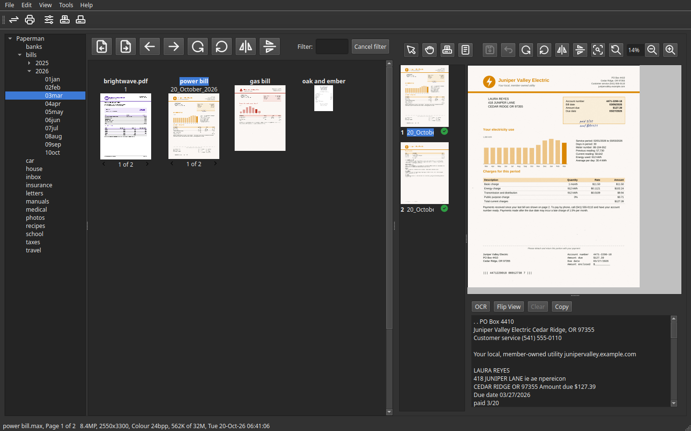
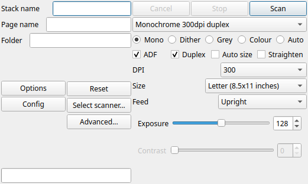

[](https://github.com/sjg20/paperman/actions/workflows/ci.yml)
[](https://sjg20.github.io/paperman/coverage/)

# Paper Manager

Visit **[getpaperman.com](https://getpaperman.com)** to
[download Paperman](https://getpaperman.com/download/),
[see what it does](https://getpaperman.com/features/) or
[try the demo](https://getpaperman.com/server-and-app/#try-it).

Paperman is an electronic filing cabinet: it scans paper into stacks of
pages and lets you view, arrange, annotate, print, search and send them.
It reads and writes PDF, JPEG and its own variant of PaperPort's .max file
format.

It has three parts: the desktop program, for Linux, Windows and macOS; a
search server, `paperman-server`, which serves repositories over the
network to the desktop program on other machines and to the app; and an
app for Android and iPhone, for finding and reading papers from a phone
or tablet. See the
[introduction](https://paperman.readthedocs.io/en/latest/introduction.html).

On Ubuntu, install it from the PPA (`ppa:sjg1/ppa`). On most Linux
distributions it is also a [snap](https://snapcraft.io/paperman)
(`sudo snap install paperman`). Windows installers, macOS disk images
and a Linux AppImage, for other distributions, come with each
[release](https://github.com/sjg20/paperman/releases/latest), and to try
something not yet released, from the artifacts of the latest
[CI run](https://github.com/sjg20/paperman/actions/workflows/ci.yml) on
master. See the
[installation guide](https://paperman.readthedocs.io/en/latest/install.html).

Full documentation is available at https://paperman.readthedocs.io

## Screenshots



A long stack, with each page's text | Finding stacks by the words on their pages
----------------------------------- | -----------------------------------------
 | 

Following the desktop's dark theme | Scanning, with presets
---------------------------------- | ----------------------
 | 

## Features

- simple GUI based around stacks and pages
- view previews and browse through pages
- move pages in and out of stacks, and drag them into a new order
- navigate through directories
- move stacks between directories
- double click to view full size page image (also on right pane)
- print stacks and pages, including page annotations
- email files as PDF with your mail program, or Gmail (Ctrl+Shift+E)
- copy files as PDF to the clipboard (Ctrl+C, paste anywhere)
- full undo/redo
- fast scanning from sheet-fed scanners, through SANE on Linux and macOS
  and TWAIN on Windows, with presets; pages cut to the sheet and
  straightened, colourless pages stored as grey or mono, blank pages left
  out, sheets fed sideways turned upright, and a misfeed or jam waiting to
  be cleared without losing pages (see the
  [scanning guide](https://paperman.readthedocs.io/en/latest/scanning.html))
- scanning from the command line (`--scan`)
- OCR with full-text search: scanned pages are read in the background
  with tesseract, each page's text is shown beside it, stacks can be found
  by the words on their pages, and the PDFs paperman makes can be searched
  and their text copied
- a search server whose repositories the desktop can show and change over
  the network, with user accounts which can be limited to some repositories
- an app for Android and iPhone, for browsing, searching and reading the
  server's repositories, and scanning into them with the phone's camera


See the [release history](https://paperman.readthedocs.io/en/latest/history.html)
for what has changed.

## Command-line usage

These are the main options. `paperman --help` lists them all and the
[command-line guide](https://paperman.readthedocs.io/en/latest/cli.html)
goes through them.

### -j <file>

Convert a file to .jpg, the JPEG image file. This produces a separate file for
each page of the document, with a _p<n> addition. So a two-page document called
fred.max will produce fred_p1.jpg and fred_p2.jpg

### -m <file>

Convert a file to .max, Paperman's native format. The new file has the same name
but with a .max extension.

### -p <file>

Convert a file to PDF. The new file has the same name but with a .pdf extension.

### -s <file>

Does an MD5 checksum of every page in every .max file in a directory. The
results are written to a file called 'checksums.md5' in the current directory.
For example:

    paperman -s /paper

The file format is a line for each page, containing space-separated fields:

    Length of filename in characters
    Filename
    Page number
    Image size in bytes
    md5 checksum, grouped by 32-bit words

For example:

    27 Property taxes  pd 2020.max 0 1093872 a3eb8cd8 b0cffff0 b845833c e370368e
    27 Property taxes  pd 2020.max 1 1093872 40f34c34 ae5f9549 158f97ab d6c1e6a8
    27 Property taxes  pd 2020.max 2 1093872 78572475 16422b9a c900d2a7 61ce49d6
    27 Property taxes  pd 2020.max 3 1093872 96562c4e cebfc3b3 5c863b22 d80abde6

### --scan [--repo DIR] [--dir SUBDIR] [--device NAME] [--pages N]

Scans into a repository without showing the GUI, using the saved scanner
settings. The stack goes into the top-level directory of the first
configured repository unless `--repo` and `--dir` say otherwise, and the
scanner is the last one used unless `--device` names another. `--pages`
stops after that many sides; otherwise scanning continues until the
feeder is empty.
`--set NAME=VALUE` sets a scanner option by its SANE name before the scan
(for example `mode=Color`, `resolution=200`, `source="ADF Duplex"` or
`page-height=355.6`, with fixed-point values in their units) and can be
repeated. `--auto-colour` stores pages that turn out to have no colour
as greyscale, or as mono when they have no shading either, as the
Auto mode in the scan window does. Progress is printed on stdout
and the exit code is 0 if at least one page was scanned. For example,
to scan two pages in colour into the 'inbox' directory of the
repository in ~/paper:

    paperman --scan --repo ~/paper --dir inbox --pages 2 --set mode=Color

For a benchmark or a test scan that should not end up in a real
repository, point `--repo` at a throwaway directory: it is used for that
run only and is not added to the configured repositories.

    mkdir -p /tmp/bench && paperman --scan --repo /tmp/bench --pages 50

Before every scan paperman turns on the fast-transfer settings a backend
offers: `buffermode=On`, so a scanner with memory scans ahead instead of
stopping after each sheet, and in colour `compression=JPEG`, so a side
arrives as under 1 MB rather than 25 MB. Both matter over USB (the
patched fujitsu backend has them; the fi-8950 runs at a third of its
speed without). A `None` chosen for compression in the scan dialog is
respected, and `--set` still overrides either.

With `PAPERMAN_SCAN_STATS=1` in the environment, paperman prints a line
of statistics on stderr at the end of every scan, in the GUI as well as
with `--scan`: sides scanned, time per side, CPU used by the display and
scanning threads, and how far the display fell behind the scanner. This
is the first thing to look at if scanning seems slow, since it says
which side is the bottleneck.

To measure the scanner itself, `tools/psip-bench.py` talks the fi-8950's
network protocol directly, with neither the SANE backend nor paperman in
the way: it scans a number of sides (default 50) as fast as the scanner
will hand them over, prints the timing of every side with `-v`, and
reports the rate, how long the scanner made it wait for each side, and
how far the feeder ran ahead. Options vary resolution, pre-pick, divided
delivery and end-of-page detection. It always stops the feeder and
closes the session, so it can be interrupted with Ctrl-C.

`tools/sane-bench.py` does the same through SANE with scanimage, so it
works over USB (fujitsu backend) as well as the network, timing each side
as it completes; for a fujitsu device it adds `buffermode=On` and, in
colour, `compression=JPEG`, which the fi-8950 needs to run at speed over
USB.

With `PAPERMAN_SNAP=<dir>` set (or `--snap <dir>`), paperman saves a
snapshot of its window as it appears on screen once a second, as
`snap-NNNN-<seconds>s.jpg` in that directory; `--clean-snaps` (or
`PAPERMAN_SNAP_CLEAN=1`) removes the snapshots already there first. This shows what the display
actually showed and when, to set against a log, which is useful when the
display seems to lag behind what paperman reports. It grabs from
paperman's own event loop, so it misses the moments paperman is busy, and
it captures screen pixels, so it needs X11 (on Wayland the snapshots come
out empty).

### -o <directory> | --ocr <directory>

Recursively process all .max files in a directory, performing OCR (Optical Character
Recognition) on each page not already read, and index the text of every stack in a
searchable SQLite FTS5 index. This is the same reading the desktop does in the
background after a scan, for a whole directory at once.

Features:
- Processes all .max files recursively in the specified directory
- Runs Tesseract OCR on each page which has not been read, so an interrupted run
  carries on where it stopped
- Keeps each page's words, with where each is, in the .max file
- Builds a full-text search index (.paperindex) for fast searching, including the
  text of PDFs
- Runs in console mode (no GUI required)

Example:

    paperman --ocr /paper/2024

This will:
1. Scan all .max files in /paper/2024 and subdirectories
2. Run OCR on each page not yet read
3. Keep the words of each page in its .max file
4. Create or update a searchable index at /paper/2024/.paperindex

### -q <query> [directory] | --search <query> [directory]

Search the OCR text index for files containing the specified query. Returns a list
of matching files with page numbers and text snippets showing the context.

Features:
- Full-text search using SQLite FTS5 with porter stemming
- Returns ranked results with highlighted search terms
- Shows file path, filename, page number, and text snippet for each match
- Supports complex queries and boolean operators
- Runs in console mode (no GUI required)

Example:

    paperman --search "invoice" /paper/2024

This will search the index at /paper/2024/.paperindex and display results like:

    Found 3 results:

    [1] expenses-jan.max (page 2)
        Path: /paper/2024/01jan/expenses-jan.max
        ...payment details for <b>invoice</b> #12345...

    [2] receipts.max (page 1)
        Path: /paper/2024/02feb/receipts.max
        ...<b>invoice</b> dated February 15th...

If no directory is specified, searches the current directory.

Note: You must run --ocr on a directory first to create the search index. The desktop
keeps its own index, at the top of each repository, up to date each time you search
from it (Edit > Search, then 'Text on the pages').

### --fake-scanner DIR

Offers a fake Fujitsu fi-8170 beside the real scanners, for trying
something out without a scanner or paper to hand. It is listed as
`FUJITSU fi-8170 (fake)` and scans pictures put in `DIR/hopper`:
`page.png` is the front of a sheet and `page.back.png` its back, fed in
order of name. `touch DIR/press-scan` presses its Scan button. Setting
`PAPERMAN_FAKE_SCANNER=DIR` does the same. It is built on Linux only;
see doc/testing.rst for what it can do.

    paperman --fake-scanner /tmp/fs


## Windows

There is an installer for x64 PCs (`paperman-setup-VERSION.exe`) and one
for Windows on Arm (`paperman-setup-VERSION-arm64.exe`), with each release
from 1.4.0 on, and built by every CI run; it needs
Windows 10 version 1809 or later, and no administrator. To scan, install
the scanner's 64-bit TWAIN driver: for the Ricoh fi-series that is
PaperStream IP (TWAIN x64), a separate download from the 32-bit one.
Sign out and back in after installing it, since PaperStream only sets the
scanner up for TWAIN when the user logs in.

To build it, use the MSYS2 MinGW64 toolchain, which is also what the CI
job uses. In a MINGW64 shell:

```
pacman -S make mingw-w64-x86_64-gcc mingw-w64-x86_64-pkgconf \
    mingw-w64-x86_64-qt6-base mingw-w64-x86_64-qt6-scxml mingw-w64-x86_64-qt6-svg \
    mingw-w64-x86_64-poppler-qt6 mingw-w64-x86_64-podofo \
    mingw-w64-x86_64-libtiff mingw-w64-x86_64-libjpeg-turbo \
    mingw-w64-x86_64-tesseract-ocr mingw-w64-x86_64-tesseract-data-eng
qmake6 paperman.pro -o Makefile.win
make -f Makefile.win
```

`make -f Makefile.win installer` builds the installer too, with Inno
Setup installed.

Scanners are driven through TWAIN rather than SANE: every TWAIN data
source installed on the machine appears in the device list. The TWAIN
back end lives in win32/twainsane.cpp and presents the same options as
SANE's fujitsu backend.

When bringing up a new scanner, run paperman from a shell with
`PAPERMAN_TWAIN_DEBUG=1` set: it logs every TWAIN operation and the
capabilities the driver reports to stderr. If colours come out with red and
blue swapped, set `PAPERMAN_TWAIN_RGB=1`. `PAPERMAN_TWAIN_DUMP=<file>` writes
the first scanned image as a PBM/PGM/PPM, exactly as the back end hands it to
paperman, which separates driver problems from filing problems. Only the TWAIN 2 data source
manager (TWAINDSM.dll, installed with any current driver) is used; set
`PAPERMAN_TWAIN_LEGACY=1` to fall back to the twain_32.dll shipped with
Windows.

## macOS

There is a disk image for Apple Silicon (`Paperman-VERSION-arm64.dmg`) and
one for Intel Macs (`Paperman-VERSION-x86_64.dmg`), with each release from
1.4.0 on, and built by every CI run. It carries its own
SANE, with the fujitsu and finet back ends from the fork which knows the
fi-8950; `scripts/mac-package.sh` makes it from a built `paperman.app`.

Paperman builds on macOS with Qt 6 and Homebrew. Homebrew's Poppler has
no Qt bindings, so Poppler is built separately:

```
brew install pkgconf podofo libtiff jpeg-turbo sane-backends cmake ninja \
    openjpeg little-cms2 fontconfig
# Qt 6 from qt.io, or with aqtinstall:
#    aqt install-qt mac desktop 6.11.3 clang_64 -m qtscxml -O ~/Qt
curl -LO https://poppler.freedesktop.org/poppler-26.09.0.tar.xz
tar xf poppler-26.09.0.tar.xz
cmake -S poppler-26.09.0 -B pbuild -G Ninja -DCMAKE_BUILD_TYPE=Release \
    -DCMAKE_INSTALL_PREFIX=$HOME/poppler \
    -DCMAKE_PREFIX_PATH="$HOME/Qt/6.11.3/macos;$(brew --prefix)" \
    -DENABLE_QT5=OFF -DENABLE_GLIB=OFF -DENABLE_NSS3=OFF \
    -DENABLE_GPGME=OFF -DENABLE_LIBCURL=OFF -DENABLE_BOOST=OFF \
    -DENABLE_HARFBUZZ=OFF
ninja -C pbuild install
export PKG_CONFIG_PATH=$HOME/poppler/lib/pkgconfig:$(brew --prefix)/lib/pkgconfig
~/Qt/6.11.3/macos/bin/qmake6 paperman.pro -o Makefile
make -f Makefile
```

That makes `paperman.app`; a build with `CONFIG+=test` makes a plain
`paperman` instead, for the tests. Use `make -f Makefile`, since the
GNUmakefile in the repository builds the other programs too. Scanners
are reached through SANE, as on Linux, from Homebrew's sane-backends;
a scanner too recent for that release, such as the fi-8950, needs a
newer SANE built from source.
On an Intel Mac, Homebrew has no ready-built packages for the latest
macOS, so `brew install` needs `--build-from-source`.

## Icons

The icons are from [Tabler Icons](https://tabler.io/icons) (MIT licence,
see images/icons/LICENSE.tabler), with the scanner icons drawn to match.
They are SVGs, in images/icons, drawn in the theme's text colour, so the
same icon suits a light or a dark theme.

## Code signing policy

Free code signing provided by [SignPath.io](https://about.signpath.io),
certificate by [SignPath Foundation](https://signpath.org).

Only the Windows program and installer which this project builds are
signed, by its release workflow, once an approver approves each
release. Committers, reviewers and approvers: Simon Glass
([@sjg20](https://github.com/sjg20)).

Once a day the desktop program asks getpaperman.com whether there is a
newer version, sending its version, the operating system, the processor
and the kind of package; this can be turned off in the options. Otherwise
this program will not transfer any information to other networked systems
unless specifically requested by the user or the person installing or
operating it. See the [privacy policy](https://getpaperman.com/privacy-policy/).

See [the full policy](doc/code-signing.rst) for how releases are signed.

## Building

The [build guide](https://paperman.readthedocs.io/en/latest/build.html)
covers each platform and component.

## Testing

Paperman includes a comprehensive test suite to verify functionality. Tests are built
using the Qt Test framework.

### Building with Tests

To build paperman with test support enabled:

    qmake6 paperman.pro CONFIG+=test -o Makefile
    make -f Makefile paperman

### Running Tests

Run all tests:

    env QT_QPA_PLATFORM=offscreen ./paperman -t

This will run all test suites including:
- **utils** - Utility function tests
- **ops** - File operation tests (duplicate, stack, unstack, rename, etc.)
- **file** - Reading and writing each file type
- **searchserver** - HTTP search server tests
- **ocrsearch** - OCR and the search index

Run one suite, or one test, by naming its class:

    env QT_QPA_PLATFORM=offscreen ./paperman -t TestOcrSearch
    env QT_QPA_PLATFORM=offscreen ./paperman -t TestOcrSearch::testOcrSearch

The tests which run tesseract are skipped if it is not installed. All tests use
temporary directories and clean up after themselves.

`make coverage` measures how much of the C++ code the tests run; master's
report is [published](https://sjg20.github.io/paperman/coverage/).


## Future Features

Here's what I'd like it to support:

- more operations on images

If you have other ideas or find a problem, please open an
[issue](https://github.com/sjg20/paperman/issues).
