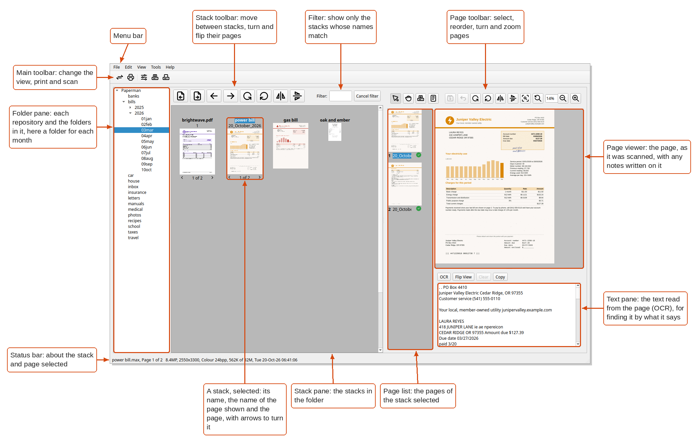
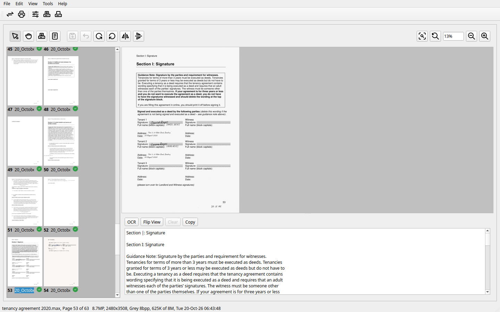
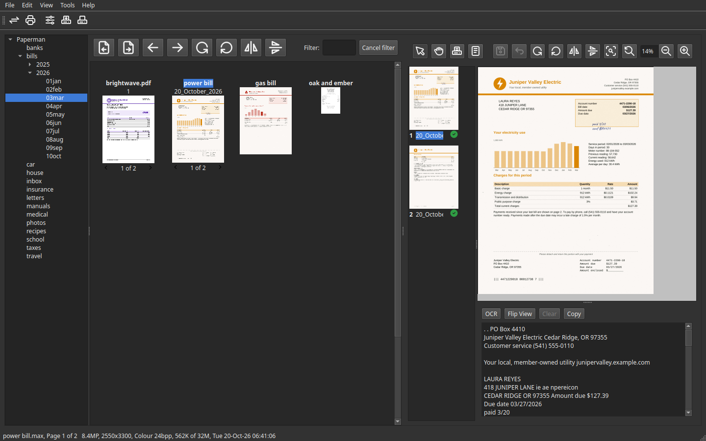

The Desktop
===========

The desktop view is the window's main view. It shows your folders, the
stacks in the folder chosen, and the stack selected.

The parts of the window are called:

Menu bar and Main toolbar
   Across the top, for the whole window.

Folder pane
   On the left: each repository and the folders in it.

Stack toolbar and Stack pane
   In the middle: the stacks in the folder chosen, with the tools for
   them above, including the **Filter**.

Preview pane
   On the right: the stack selected. It has a **Page toolbar** above, the
   **Page list** of the stack's pages, the **Page viewer** showing a
   page, and the **Text pane** below with the text read from it.

Status bar
   Along the bottom: about the stack and page selected.

Beside the desktop view there is the **Page view**, which gives the
whole window to a stack's pages, and the **Scan panel**, a window of its
own for scanning (see :doc:`scanning`).

Main toolbar
------------

.. list-table::
   :widths: 10 90

   * - |main-swap|
     - Swap between the desktop view and the page view
   * - |main-print|
     - Print the stack selected (Ctrl+P)
   * - |main-options|
     - Change the scanning options
   * - |main-scango|
     - Scan now, with the scan panel's settings (F5)
   * - |main-pscan|
     - Open the scan panel (F6)

Folder pane
-----------

The folder pane shows each repository and the folders in it. Click a
folder to show its stacks; click the arrow beside it to see the folders
inside.

- **Edit > Go to folder** (Ctrl+F or F4) finds a folder by part of its
  name, which is quicker than opening one level after another:

  .. image:: images/go-to-folder.png
     :alt: Going to a folder by typing jun, which finds bills/2026/06jun

- **View > Filter year/month** (Ctrl+Shift+F) hides the folders named for
  another year or month, leaving this year's and this month's, for those
  who file by month (see :doc:`getting-started`).

Stack toolbar
-------------

.. list-table::
   :widths: 10 90

   * - |stack-pprev|
     - Turn the stack selected to its previous page (Page Up)
   * - |stack-pnext|
     - Turn it to its next page (Page Down)
   * - |stack-prev|
     - Select the stack before (Ctrl+Page Up)
   * - |stack-next|
     - Select the stack after (Ctrl+Page Down)
   * - |stack-rleft|
     - Turn every page of the stacks selected to the left (Alt+Left)
   * - |stack-rright|
     - Turn every page of them to the right (Alt+Right)
   * - |stack-hflip|
     - Flip every page of them from left to right
   * - |stack-vflip|
     - Flip every page of them upside down
   * - **Filter**
     - Type a few letters to show only the stacks whose names have them
       in, and **Cancel filter** to show them all again

Stack pane
----------

Each stack in the folder is shown with its name, the name of the page
shown (by default, when it was scanned) and a picture of that page.
Below a stack of more than one page are its page count and arrows to turn
its pages.

- Click a stack to select it, Ctrl-click to add more, and **Edit > Select
  all** (Ctrl+A) to select every one. The arrow keys move from stack to
  stack.
- **Tools > Arrange** lines the stacks up by name or by date, or leaves
  them where you put them.
- Double-click a stack to open it in the page view.

Anything done to stacks can be undone with **Edit > Undo** (Ctrl+Z).

Preview pane
------------

The preview pane shows the stack selected: the **Page list** of its pages
down the side, the **Page viewer** with the page itself, and the **Text
pane** below it.

The green tick by each page in the page list marks it to keep: click it
to mark the page to be removed instead, as the blank pages from a scan
can be.

Page toolbar
~~~~~~~~~~~~

.. list-table::
   :widths: 10 90

   * - |page-selectmode|
     - Select pages: click one, and Ctrl-click to add more
   * - |page-movemode|
     - Reorder pages: drag those selected to where they should go
   * - |page-scanmode|
     - Show each page as it is scanned
   * - |page-infomode|
     - Show and change the stack's title, author, keywords and notes
   * - |page-save|
     - Save the changes made to the stack's pages
   * - |page-revert|
     - Go back to the stack as it was last saved
   * - |page-rleft|
     - Turn the page to the left
   * - |page-rright|
     - Turn the page to the right
   * - |page-hflip|
     - Flip the page from left to right
   * - |page-vflip|
     - Flip the page upside down
   * - |page-zoomfit|
     - Fit the whole page in the page viewer
   * - |page-zoomorig|
     - Zoom to the smallest size at which the page can still be read
   * - **Zoom box**
     - The zoom, as a percentage, which can also be typed in
   * - |page-zoomout|
     - Zoom out
   * - |page-zoomin|
     - Zoom in

Text pane
~~~~~~~~~

.. list-table::
   :widths: 20 80

   * - **OCR**
     - Read the text of the page again
   * - **Flip View**
     - Put the text beside the page rather than below it, or back
   * - **Clear**
     - Clear the text
   * - **Copy**
     - Copy the text to the clipboard

Page view
---------

Double-click a stack, or press |main-swap| in the main toolbar, to give
the whole window to the stack's pages. The same button goes back to the
desktop view.

Light or dark
-------------

Paperman follows the desktop's light or dark theme. To choose one or the
other whatever the desktop does, use **File > Options**, *Appearance*.

.. |stack-rright| image:: images/icons/stack-rright.png
.. |stack-hflip| image:: images/icons/stack-hflip.png

.. |page-rleft| image:: images/icons/page-rleft.png

.. |page-vflip| image:: images/icons/page-vflip.png

