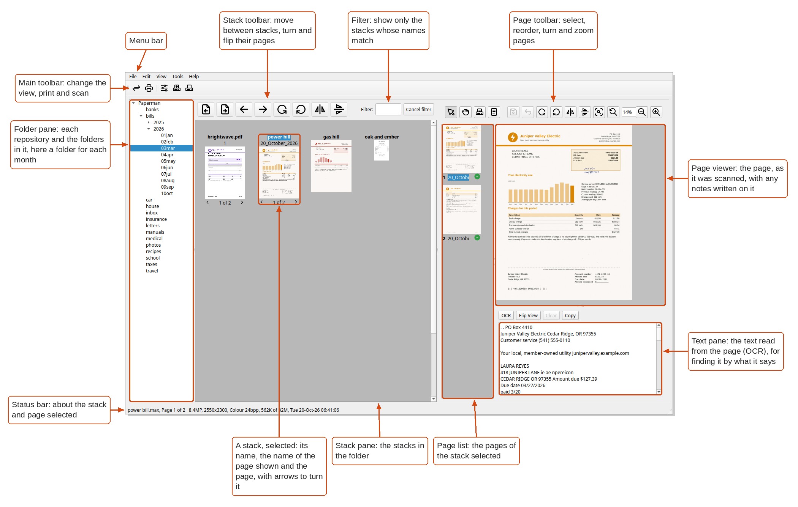
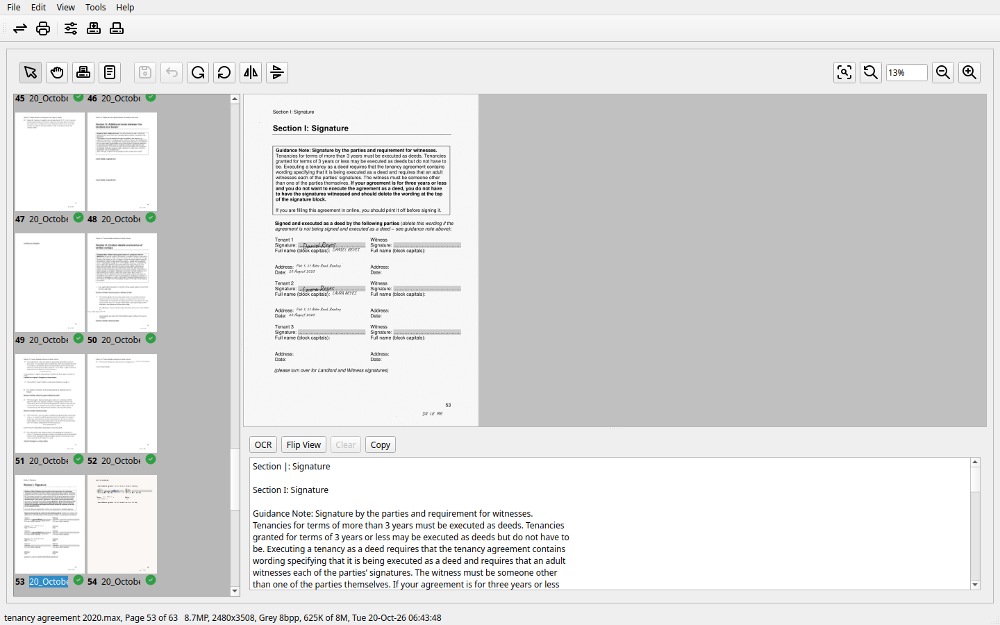
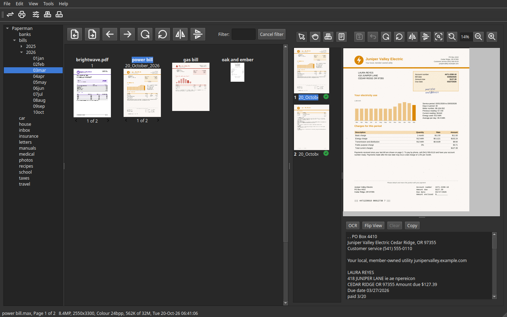

The Desktop
===========

The desktop view is the window's main view. It shows your folders, the
stacks in the folder chosen, and the stack selected.

The parts of the window are called:

Menu bar and Main toolbar
   Across the top, for the whole window.

Folder pane
   On the left: each repository and the folders in it.

Stack toolbar and Stack pane
   In the middle: the stacks in the folder chosen, with the tools for
   them above, including the **Filter**.

Preview pane
   On the right: the stack selected. It has a **Page toolbar** above, the
   **Page list** of the stack's pages, the **Page viewer** showing a
   page, and the **Text pane** below with the text read from it.

Status bar
   Along the bottom: about the stack and page selected.

Beside the desktop view there is the **Page view**, which gives the
whole window to a stack's pages, and the **Scan panel**, a window of its
own for scanning (see :doc:`scanning`).

Main toolbar
------------

.. list-table::
   :widths: 10 90

   * - |main-swap|
     - Swap between the desktop view and the page view
   * - |main-print|
     - Print the stack selected (Ctrl+P)
   * - |main-options|
     - Change the scanning options
   * - |main-scango|
     - Scan now, with the scan panel's settings (F5)
   * - |main-pscan|
     - Open the scan panel (F6)

Folder pane
-----------

The folder pane shows each repository and the folders in it. Click a
folder to show its stacks; click the arrow beside it to see the folders
inside.

- **Edit > Go to folder** (Ctrl+F or F4) finds a folder by part of its
  name, which is quicker than opening one level after another:

  .. image:: images/go-to-folder.png
     :alt: Going to a folder by typing jun, which finds bills/2026/06jun

- **View > Filter year/month** (Ctrl+Shift+F) hides the folders named for
  another year or month, leaving this year's and this month's, for those
  who file by month (see :doc:`getting-started`).

Stack toolbar
-------------

.. list-table::
   :widths: 10 90

   * - |stack-pprev|
     - Turn the stack selected to its previous page
   * - |stack-pnext|
     - Turn it to its next page
   * - |stack-prev|
     - Select the stack before
   * - |stack-next|
     - Select the stack after
   * - |stack-rleft|
     - Turn every page of the stacks selected to the left (Alt+Left)
   * - |stack-rright|
     - Turn every page of them to the right (Alt+Right)
   * - |stack-hflip|
     - Flip every page of them from left to right
   * - |stack-vflip|
     - Flip every page of them upside down
   * - **Filter**
     - Type a few letters to show only the stacks whose names have them
       in, and **Cancel filter** to show them all again

Stack pane
----------

Each stack in the folder is shown with its name, the name of the page
shown (by default, when it was scanned) and a picture of that page.
Below a stack of more than one page are its page count and arrows to turn
its pages. A stack with a cover is shown by its cover, like a closed
book (see `Cropping`_).

- Click a stack to select it, Ctrl-click to add more, and **Edit > Select
  all** (Ctrl+A) to select every one. The arrow keys move from stack to
  stack.
- **Tools > Arrange** lines the stacks up by name or by date, or leaves
  them where you put them.
- Double-click a stack to open it in the page view.

Anything done to stacks can be undone with **Edit > Undo** (Ctrl+Z).

Preview pane
------------

The preview pane shows the stack selected: the **Page list** of its pages
down the side, the **Page viewer** with the page itself, and the **Text
pane** below it.

The green tick by each page in the page list marks it to keep: click it
to mark the page to be removed instead, as the blank pages from a scan
can be.

Drag pages by their images in the page list to put them in a new order:
select one, or Ctrl-click to select more, and drag them to where they
should go, shown by a line between the pages. To select several at once,
drag across them starting from a caption or a gap between pages. Ctrl with an arrow key moves the pages
selected one place earlier or later.
**Undo** puts them back. A stack on a server cannot be reordered yet.

Page toolbar
~~~~~~~~~~~~

.. list-table::
   :widths: 10 90

   * - |page-selectmode|
     - Select pages: click one, and Ctrl-click to add more
   * - |page-movemode|
     - Select and reorder pages, as the select tool does
   * - |page-scanmode|
     - Show each page as it is scanned
   * - |page-infomode|
     - Show and change the stack's title, author, keywords and notes
   * - |page-save|
     - Save the changes made to the stack's pages
   * - |page-revert|
     - Go back to the stack as it was last saved
   * - |page-rleft|
     - Turn the page to the left
   * - |page-rright|
     - Turn the page to the right
   * - |page-hflip|
     - Flip the page from left to right
   * - |page-vflip|
     - Flip the page upside down
   * - |page-crop|
     - Cut away the edges of the page: see `Cropping`_
   * - |page-zoomfit|
     - Fit the whole page in the page viewer
   * - |page-zoomorig|
     - Zoom to the smallest size at which the page can still be read
   * - **Zoom box**
     - The zoom, as a percentage, which can also be typed in
   * - |page-zoomout|
     - Zoom out
   * - |page-zoomin|
     - Zoom in

Text pane
~~~~~~~~~

.. list-table::
   :widths: 20 80

   * - **OCR**
     - Read the text of the page again
   * - **Flip View**
     - Put the text beside the page rather than below it, or back
   * - **Clear**
     - Clear the text
   * - **Copy**
     - Copy the text to the clipboard

Cropping
--------

Press |page-crop| to crop the page shown. A box appears around the whole
page. Drag on the page to draw a new box around the part to keep, and
anything outside it is shaded. Drag an edge or corner to adjust the box,
or use these buttons to set it:

.. list-table::
   :widths: 20 80

   * - |page-crop-content|
     - Put the box around what is printed on the page. Where the scanner's
       dark background shows around the sheet, the box stops at the edge
       of the paper instead
   * - |page-crop-full|
     - Put the box around the whole page

Then use the buttons on the right of the bar:

.. list-table::
   :widths: 20 80

   * - |page-crop-page|
     - **Crop page**: crop just this page. Pressing Enter does the same
   * - |page-crop-stack|
     - **Crop stack**: crop every page in the stack to the same part of the
       page. Pressing Shift+Enter does the same
   * - |page-crop-trim|
     - **Trim stack to content**: crop every page to what is printed on that
       page. A page with little on it ends up small
   * - |page-crop-cover|
     - **Set cover**: make the part marked the stack's front cover, such as
       the front of a book's dust jacket scanned flat, without cropping
       anything. With the whole page marked, the whole page is the cover.
       A stack has one cover, so this takes it from any other page. The
       desktop then shows the stack by its cover. Only a ``.max`` stack on
       this computer can have a cover for now
   * - |page-crop-cancel|
     - **Cancel**: leave the page as it is. Pressing Escape does the same

**Edit > Undo** puts back everything a crop removed. The words read from a
``.max`` page are dropped when it is cropped, since some may have been cut
away, and undo brings them back.

On the desktop, a stack with a cover takes the cover's size. On the cover
page it shows just the cover, and its other pages are shrunk to fit that
size, so that the stack looks like the book when it is closed and stays
the same size as its pages are turned. Setting a cover does not turn the
stack to the cover page, and the page list still shows each page whole.

The page which is the cover has a small book by it in the page list. When
the crop bar is opened on that page, the box starts around the cover, so
that it can be adjusted. Right-click the page in the page list and choose
**Clear cover** for the stack to have no cover. A cover follows the page
when it is turned, flipped or cropped, going if a crop cuts all of it
away, and **Edit > Undo** puts back the cover there was.

.. note::

   A crop is not a safe way to remove something private. A PDF keeps the
   whole page and only shows part of it, and a ``.max`` stack keeps the old
   page in the file so that it can be brought back.

Page view
---------

Double-click a stack, or press |main-swap| in the main toolbar, to give
the whole window to the stack's pages. The same button goes back to the
desktop view.

Light or dark
-------------

Paperman follows the desktop's light or dark theme. To choose one or the
other whatever the desktop does, use **File > Options**, *Appearance*.

.. |stack-rleft| image:: images/icons/stack-rleft.png
.. |stack-rright| image:: images/icons/stack-rright.png
.. |stack-hflip| image:: images/icons/stack-hflip.png
.. |stack-vflip| image:: images/icons/stack-vflip.png

