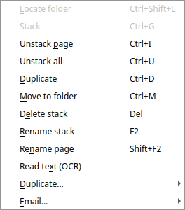
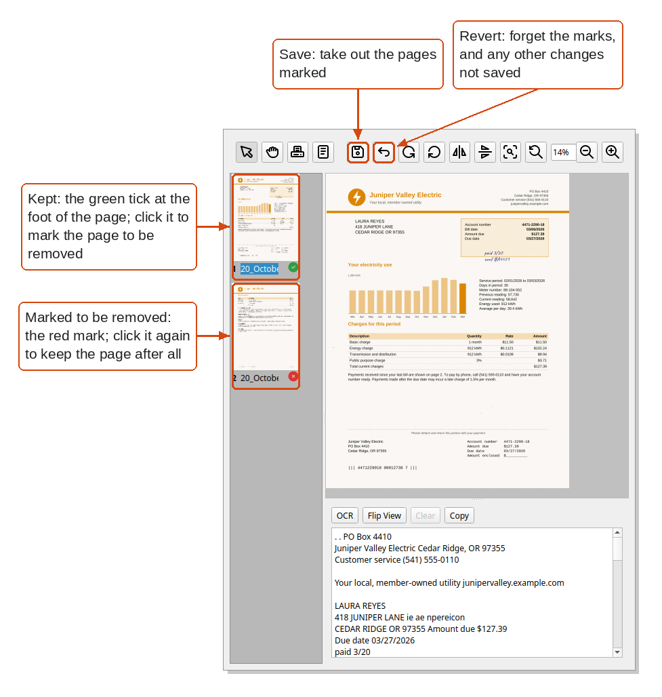
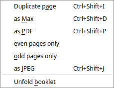
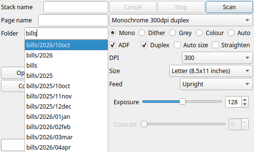
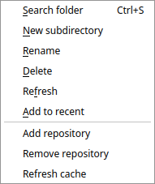

Filing
======

A stack is a file in a folder, and filing is moving it to the right
folder, putting pages together or apart, and naming things so that they
can be found again. Paperman lets you do each of these, and anything
done to stacks can be undone with **Edit > Undo** (Ctrl+Z).

The stack menu
--------------

Right-click a stack in the stack pane for the things which can be done
with it, or with all the stacks selected:

.. list-table::
   :widths: 30 70

   * - **Locate folder** (Ctrl+Shift+L)
     - In the results of a search, go to the folder the stack is in (see
       :doc:`finding`)
   * - **Stack** (Ctrl+G)
     - Put the stacks selected together into one: the pages of the others
       go into the first one selected, just before the page it shows
   * - **Unstack page** (Ctrl+I)
     - Take the page shown out of its stack, into a stack of its own
   * - **Unstack all** (Ctrl+U)
     - Split each stack selected into a stack for each page
   * - **Duplicate** (Ctrl+D)
     - Make a copy of each stack selected
   * - **Move to folder** (Ctrl+M)
     - Move the stacks selected to another folder, chosen by typing part
       of its name (see below)
   * - **Delete stack** (Del)
     - Move the stacks selected to the repository's trash, after asking.
       Undo brings them back
   * - **Rename stack** (F2)
     - Give the stack a new name
   * - **Rename page** (Shift+F2)
     - Give the page shown a new name
   * - **Read text (OCR)**
     - Redo the OCR, reading the text of the stack's pages again (see
       :doc:`finding`)
   * - **Duplicate...**
     - Copy a page, or a stack in another form (see `Duplicating`_)
   * - **Email...**
     - Send the stacks by email

Moving stacks
-------------

There are two ways to move stacks to another folder:

- **Drag** them onto the folder in the folder pane:

  .. image:: images/drag-to-folder-labelled.png
     :alt: Dragging a stack from the stack pane onto a folder in the folder pane
     :target: _images/drag-to-folder-labelled.png

- **Move to folder** (Ctrl+M) asks for the folder: type part of its
  name and pick it from the list. Tick **Copy instead of moving** to
  leave the stacks where they are and put copies in the folder.

  .. image:: images/move-to-folder.png
     :alt: Moving a stack, typing tax to find the taxes folder

Within the stack pane, drag a stack to put it where you want it. **Tools
> Arrange** lines the stacks up by name or by date instead.

Putting pages together and apart
--------------------------------

- A letter scanned in two goes, or a bill and its receipt, become one
  stack with **Stack** (Ctrl+G): select the stack to keep first, turned
  to the page the others should go before, then the others, and press
  Ctrl+G.
- A page which belongs elsewhere comes out with **Unstack page**
  (Ctrl+I), as a stack of its own, which can then be stacked with another.
- A pile of single sheets scanned as one stack comes apart with
  **Unstack all** (Ctrl+U).
- The pages of a stack are put in a new order with the reorder tool in
  the page toolbar (see :doc:`desktop`): select pages, then drag them
  to where they should go.
- A page not wanted, such as a blank one, is taken out as below.

Removing pages
--------------

Each page in the page list has a green tick at its foot, which marks it
to be kept. To take a page out of a stack:

#. Click the page's tick. It turns into a red mark, showing that the
   page is to be removed. Click it again to keep the page after all.
#. Mark any other pages to go in the same way.
#. Press **Save** in the page toolbar. The pages marked are taken out of
   the stack.

Until then nothing is lost: **Revert** forgets the marks, along with any
other changes not saved. Blank pages from a scan can come marked
already, if the scan settings say to leave them out (see
:doc:`scanning`).

Duplicating
-----------

**Duplicate** (Ctrl+D) copies the stacks selected as they are. The
**Duplicate...** submenu, in a stack's right-click menu, copies part of a
stack, or a stack in another form. Each copy goes beside the original,
named after it.

.. list-table::
   :widths: 35 65

   * - **Duplicate page** (Ctrl+Shift+I)
     - Copy the page shown into a stack of its own
   * - **as Max** (Ctrl+Shift+D)
     - Copy each stack as a ``.max`` stack, which suits one which is a
       PDF or JPEG
   * - **as PDF** (Ctrl+Shift+P)
     - Copy each stack as a PDF, with the text of its pages if it has
       been read
   * - **even pages only**, **odd pages only**
     - Copy just the even or the odd pages into a new stack
   * - **as JPEG** (Ctrl+Shift+J)
     - Copy each page as a JPEG picture
   * - **Unfold booklet**
     - For a booklet scanned two pages to a sheet: split each page down
       the middle and put the halves in reading order, in a new stack
       named after the original with ``_unfold``

Names
-----

A stack scanned without a name is named for the day, such as
``20-Oct-26``, and its pages for the date, such as ``20_October_2026``.

To rename a stack, select it and press **F2**. To rename the page shown,
press **Shift+F2**. Give a stack a name which says what it is, such as
*power bill*: searching by name looks at these names.

Dates
-----

Paperman looks for dates in the names of folders, so that papers filed
by date are easy to keep up with:

- A **year** is four digits from 1900 to 2099 on their own in a name,
  such as ``2026`` or ``taxes 2025``.
- A **month** is two digits and the first three letters of its name,
  ``01jan`` to ``12dec``, such as ``bills/2026/10oct``. The digits keep
  the months in order when the folders are sorted by name.

With those in the names:

- The scan panel's folder list, before anything is typed, puts this
  month's folders first, then this year's, then those with no date, and
  leaves out those named for another year or month. Typing lists every
  folder which matches, old ones last.
- When there is a folder for last month but not this one, the list
  offers to make it, as ``<Add: bills/2026/11nov>``; choosing that makes
  the folder, ready to scan into. A folder for last year, with no month,
  is offered for this year in the same way.
- **View > Filter year/month** (Ctrl+Shift+F) hides, in the folder pane,
  the folders named for another year or month.
- **Edit > Go to folder** (Ctrl+F) finds dated folders like any others,
  so typing ``jun`` goes to June's.

Stacks are dated too:

- A stack scanned without a name is named for the day it was scanned,
  and its pages for the date (see `Names`_).
- **Tools > Arrange > by Date** lines the stacks up by when each was last
  changed.

Folders
-------

Right-click a folder in the folder pane for the things which can be done
with it:

- **Search folder** (Ctrl+S) searches the folder and those inside it
  (see :doc:`finding`).
- **New subdirectory** and **Rename** make and rename folders.
  **Delete** is not done in Paperman: delete the folder with your file
  manager, then use **Refresh**.
- **Refresh** and **Refresh cache** read the folders afresh, after
  changes made outside Paperman.
- **Add repository** and **Remove repository** add a folder of papers to
  the folder pane or take one away; removing a repository leaves its
  files alone.

Folders named for a year and a month, such as ``bills/2026/10oct``, are
the ones the scan panel suggests (see :doc:`getting-started`).
