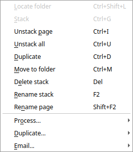
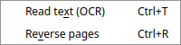

Filing
======

A stack is a file in a folder, and filing is moving it to the right
folder, putting pages together or apart, and naming things so that they
can be found again. Paperman lets you do each of these, and anything
done to stacks can be undone with **Edit > Undo** (Ctrl+Z).

The stack menu
--------------

Right-click a stack in the stack pane for the things which can be done
with it, or with all the stacks selected:

.. list-table::
   :widths: 30 70

   * - **Locate folder** (Ctrl+Shift+L)
     - In the results of a search, go to the folder the stack is in (see
       :doc:`finding`)
   * - **Stack** (Ctrl+G)
     - Put the stacks selected together into one: the pages of the others
       go into the first one selected, just before the page it shows
   * - **Unstack page** (Ctrl+I)
     - Take the page shown out of its stack, into a stack of its own
   * - **Unstack all** (Ctrl+U)
     - Split each stack selected into a stack for each page
   * - **Duplicate** (Ctrl+D)
     - Make a copy of each stack selected
   * - **Move to folder** (Ctrl+M)
     - Move the stacks selected to another folder, chosen by typing part
       of its name (see below)
   * - **Delete stack** (Del)
     - Move the stacks selected to the repository's trash, after asking.
       Undo brings them back
   * - **Rename stack** (F2)
     - Give the stack a new name
   * - **Rename page** (Shift+F2)
     - Give the page shown a new name
   * - **Process...**
     - Read a stack's text, turn its pages round or have the assistant
       work on it (see `The Process menu`_)
   * - **Duplicate...**
     - Copy a page, or a stack in another form (see `Duplicating`_)
   * - **Email...**
     - Send the stacks by email

Every item has a shortcut, shown beside it in the menu, which works on
the stacks selected without opening the menu.

The Process menu
~~~~~~~~~~~~~~~~

The **Process...** submenu holds the things which work on what is in a
stack, rather than on where it is or what it is called:

.. list-table::
   :widths: 35 65

   * - **Read text (OCR)** (Ctrl+T)
     - Read the text of the stack's pages which have none yet, leaving
       those already read as they are (see :doc:`finding`)
   * - **Suggest name** (Ctrl+F2)
     - Ask an AI model for a name for each stack selected, from what its
       pages say (see `Suggesting a name`_). Shown once it is turned on
       in the options
   * - **Split into documents...** (Ctrl+Shift+U)
     - Ask an AI model where a stack scanned as one pile divides into
       separate documents (see `Splitting a pile into documents`_). Shown
       once it is turned on in the options
   * - **Suggest folder...** (Ctrl+F3)
     - Ask an AI model which folder each stack selected belongs in, and
       move them once you have checked (see `Suggesting a folder`_).
       Shown once it is turned on in the options
   * - **Reverse pages** (Ctrl+R)
     - Put the pages of each stack selected in the opposite order, as for
       a pile scanned from the back. Undo puts them back

Moving stacks
-------------

There are two ways to move stacks to another folder:

- **Drag** them onto the folder in the folder pane:

  .. image:: images/drag-to-folder-labelled.png
     :alt: Dragging a stack from the stack pane onto a folder in the folder pane
     :target: _images/drag-to-folder-labelled.png

- **Move to folder** (Ctrl+M) asks for the folder: type part of its
  name and pick it from the list. Tick **Copy instead of moving** to
  leave the stacks where they are and put copies in the folder.

  .. image:: images/move-to-folder.png
     :alt: Moving a stack, typing tax to find the taxes folder

Within the stack pane, drag a stack to put it where you want it. **Tools
> Arrange** lines the stacks up by name or by date instead.

A picture or document from somewhere else on the computer comes in by
dragging it from a file manager onto the stack pane: a JPEG, PDF or max
file becomes a stack in the folder shown, where it is dropped. The folder
gets a copy and the file stays where it was. Dropped onto a max or PDF
stack, which shows a pages symbol as the file passes over it, the file
is converted to that type and its pages join the stack, at the page it
is turned to. Dropped among the pages in the page list, it goes in
where the line shows. **Edit > Undo** takes it out again.

Putting pages together and apart
--------------------------------

- A letter scanned in two goes, or a bill and its receipt, become one
  stack with **Stack** (Ctrl+G): select the stack to keep first, turned
  to the page the others should go before, then the others, and press
  Ctrl+G. Dragging one stack onto another does the same. A stack of
  another type, such as a JPEG picture put onto a max or PDF stack, is
  converted to the type of the stack it joins.
- To choose where the pages go, click the stack to keep, so that its
  pages are in the page list, then drag the other stack from the stack
  pane into the page list. The stack to keep stays shown while the other
  is dragged, and a line between its pages shows where the others will
  go. Several stacks selected can be dragged in together.
- A page which belongs elsewhere comes out with **Unstack page**
  (Ctrl+I), as a stack of its own, which can then be stacked with another.
- A pile of single sheets scanned as one stack comes apart with
  **Unstack all** (Ctrl+U).
- The pages of a stack are put in a new order by dragging them in the
  page list (see :doc:`desktop`): select pages, then drag them to where
  they should go, or move them with Ctrl and an arrow key.
- A page not wanted, such as a blank one, is taken out as below.

Removing pages
--------------

Each page in the page list has a green tick at its foot, which marks it
to be kept. To take a page out of a stack:

#. Click the page's tick. It turns into a red mark, showing that the
   page is to be removed. Click it again to keep the page after all.
#. Mark any other pages to go in the same way.
#. Press **Save** in the page toolbar. The pages marked are taken out of
   the stack.

Until then nothing is lost: **Revert** forgets the marks, along with any
other changes not saved. Blank pages from a scan can come marked
already, if the scan settings say to leave them out (see
:doc:`scanning`).

.. image:: images/page-remove-labelled.png
   :alt: The preview pane, with one page kept and one marked to be removed
   :target: _images/page-remove-labelled.png

Duplicating
-----------

**Duplicate** (Ctrl+D) copies the stacks selected as they are. The
**Duplicate...** submenu, in a stack's right-click menu, copies part of a
stack, or a stack in another form. Each copy goes beside the original,
named after it.

.. image:: images/duplicate-menu.png
   :alt: The Duplicate submenu

.. list-table::
   :widths: 35 65

   * - **Duplicate page** (Ctrl+Shift+I)
     - Copy the page shown into a stack of its own
   * - **as Max** (Ctrl+Shift+D)
     - Copy each stack as a ``.max`` stack, which suits one which is a
       PDF or JPEG
   * - **as PDF** (Ctrl+Shift+P)
     - Copy each stack as a PDF, with the text of its pages if it has
       been read
   * - **even pages only** (Ctrl+Shift+N), **odd pages only**
       (Ctrl+Shift+O)
     - Copy just the even or the odd pages into a new stack
   * - **as JPEG** (Ctrl+Shift+J)
     - Copy each page as a JPEG picture
   * - **Unfold booklet** (Ctrl+Shift+B)
     - For a booklet scanned two pages to a sheet: split each page down
       the middle and put the halves in reading order, in a new stack
       named after the original with ``_unfold``

Names
-----

A stack scanned without a name is named for the day, such as
``20-Oct-26``, and its pages for the date, such as ``20_October_2026``.

To rename a stack, select it and press **F2**. To rename the page shown,
press **Shift+F2**. Give a stack a name which says what it is, such as
*power bill*: searching by name looks at these names.

Suggesting a name
~~~~~~~~~~~~~~~~~

Paperman can ask an AI model for a name, from what the stack's pages say.
This is off at first, since it sends text from your papers to the model.
To turn it on, tick **Use an AI assistant to help with filing** in the
**Assistant** tab of the options.

Then right-click a stack and choose **Process... > Suggest name**, or
press Ctrl+F2. The name appears in the name box: press **Enter** to
accept it, change it first, or press **Esc** to keep the old name. Undo
puts the old name back.

The answer takes a few seconds, and you need not wait for it. If you
have selected another stack by then, or are typing a name, the name
suggested is shown in a small window instead, to accept or not when you
are ready.

Paperman looks at the stack's first eight pages, since the title of a
book or a report is often clearer a few pages in than on its cover. If
few of them have text yet, it reads them first, which takes a few
seconds. What it reads then is used for the name and not kept: **Read
text (OCR)** is still what lets the stack be found by what it says.

With several stacks selected, Paperman asks for a name for each, a few
at a time, then shows them all in one window:

- Each stack has a tick, the name it has, and the name suggested, which
  can be changed.
- A stack which is not ticked keeps its name. One with nothing to name
  it from says so, and starts unticked.
- **Rename** renames the stacks ticked, as one step: a single **Undo**
  puts all the old names back.

The other stacks selected are not sent as examples of how you name
things, since they are the ones waiting for names. While the names are
being asked for, the work is listed in **View > Background work**,
where it can be stopped. The window of names does not stop you doing
other things, and only one lot of names is asked for at a time: asking
again before the first lot has come says so, and does nothing.

Facts about the document
^^^^^^^^^^^^^^^^^^^^^^^^

With each name the model also says what the text states about the
document: what kind it is, who it is from, its date, the period it
covers, its main amount, and a line saying what it is. Nothing more is
sent to get them. Paperman keeps them in the stack's own file, so they go
wherever the stack goes, ready for finding papers by more than their
names.

- For one stack they are kept when you accept the name with **Enter**,
  whatever you change the name to, and not if you press **Esc**.
- For several, the window shows the kind, the sender, the date and the
  amount beside each name, and each can be put right before **Rename**.
  A stack which is ticked keeps its facts even if its name stays as it
  is.
- **Undo** takes them away again, along with the name.
- A fact which the text does not give is left out, and a date or an
  amount which is not in a plain form is dropped.

To see a stack's facts later, or to put them right, select the stack and
press |page-infomode| in the page toolbar. They are under **About the
document**, below the notes: change any of them, or type them in for a
stack the assistant has not named, and press |page-save| to keep them.
The date is written as year-month-day (or just the year and month, or
the year), the amount as a number and the currency as three letters; one
which is not in that form is dropped when you save. **Undo** takes the
change back.

Facts are kept for ``.max`` and PDF stacks on this computer. A JPEG stack
has nowhere to hold them, and a stack on a server does not keep them yet.

What is sent is the text of up to four of those pages, the first ones
which say anything, and the names of up to twenty other stacks in its
folder, which show how you name things. Nothing is sent unless you choose
**Suggest name**.

The model is reached through the ``claude`` command of Claude Code, which
must be installed and signed in; Paperman holds no key or password. It
runs with no tools, so it can only read what it is given and answer. The
**Command** and **Model** boxes in the same tab change which command is
run and which model it asks.

Splitting a pile into documents
~~~~~~~~~~~~~~~~~~~~~~~~~~~~~~~

The quickest way to scan a day's post is as one pile, which arrives as one
stack. With the assistant turned on, as above, Paperman can ask the AI
model where each document in it starts, and what to call it.

Right-click the stack and choose **Process... > Split into
documents...**, or press Ctrl+Shift+U. After a few
moments a window shows what the model suggests: a row for each document,
with a picture of its first page, its pages and a name, and what the
model found about it: its kind, its sender, its date and its amount (see
`Facts about the document`_). Nothing has changed yet. In the window:

- double-click a name to change it
- select a document and press **Join with previous** where the stack is
  divided in a place it should not be: its pages go to the document above

Press **Split** to divide the stack, or **Cancel** to leave it alone. The
first document keeps the stack's place, with its new name, and the others
appear after the other stacks in the folder. Each keeps the facts found
about its document, which can be seen and put right afterwards with
|page-infomode|; a document joined to the one above leaves its own
behind. One undo puts the stack back together, with its old name and
without the facts.

Every page needs its text, so a stack scanned before Paperman read text
needs **Read text (OCR)** first. A page with no text stays with the one
before it. The most pages a stack can have for this is 200.

What is sent is the start of the text of every page of the stack, and the
names of up to twenty other stacks in its folder. Nothing is sent unless
you choose **Split into documents...**.

Suggesting a folder
~~~~~~~~~~~~~~~~~~~

Once stacks have names, they need filing. With the assistant turned on,
as above, Paperman can ask the AI model which folder each belongs in.

Select the stacks, right-click and choose **Process... > Suggest
folder...**, or press Ctrl+F3. After a few moments a window lists each
stack with the folder suggested for it. Nothing has moved yet. In the
window:

- untick a stack to leave it where it is
- double-click a folder to change it: as you type, the folders with
  those letters anywhere in their paths are offered
- a stack for which the model found no folder to fit says so, and starts
  unticked; give it a folder and tick it to move it too

Press **Move** to file the stacks ticked, or **Cancel** to leave them
all. The window can be left open while you do other things.

The folders to choose from are the ones the scan panel offers: every
folder in the repository, leaving out those named for another year or
month than this one (see :doc:`getting-started`). The model can only
pick one of those: a folder it invents is refused. A stack is filed by
what it is and who it is from, and, among folders named for months, by
the document's own date.

The stacks are moved as one step, which **Edit > Undo** takes back. In
**View > Activity** the step is listed as the assistant's, with each
stack under it, and each leads to the stack where it now is (see
:doc:`desktop`).

What is sent for each stack is the text of its first pages, as for a
name, with the stack's name, today's date and the names of the folders
offered. Nothing is sent unless you choose **Suggest folder...**.

Dates
-----

Paperman looks for dates in the names of folders, so that papers filed
by date are easy to keep up with:

- A **year** is four digits from 1900 to 2099 on their own in a name,
  such as ``2026`` or ``taxes 2025``.
- A **month** is two digits and the first three letters of its name,
  ``01jan`` to ``12dec``, such as ``bills/2026/10oct``. The digits keep
  the months in order when the folders are sorted by name.

With those in the names:

- The scan panel's folder list, before anything is typed, puts this
  month's folders first, then this year's, then those with no date, and
  leaves out those named for another year or month. Typing lists every
  folder which matches, old ones last.
- When there is a folder for last month but not this one, the list
  offers to make it, as ``<Add: bills/2026/11nov>``; choosing that makes
  the folder, ready to scan into. A folder for last year, with no month,
  is offered for this year in the same way.
- **View > Filter year/month** (Ctrl+Shift+F) hides, in the folder pane,
  the folders named for another year or month.
- **Edit > Go to folder** (Ctrl+F) finds dated folders like any others,
  so typing ``jun`` goes to June's.

.. image:: images/scan-folders.png
   :alt: The scan panel listing this month's folder first

Stacks are dated too:

- A stack scanned without a name is named for the day it was scanned,
  and its pages for the date (see `Names`_).
- **Tools > Arrange > by Date** lines the stacks up by when each was last
  changed.

Folders
-------

Right-click a folder in the folder pane for the things which can be done
with it:

.. image:: images/folder-menu.png
   :alt: The menu of things to do with a folder

- **Search folder** (Ctrl+S) searches the folder and those inside it
  (see :doc:`finding`).
- **New subdirectory** and **Rename** make and rename folders.
  **Delete** is not done in Paperman: delete the folder with your file
  manager, then use **Refresh**.
- **Refresh** and **Refresh cache** read the folders afresh, after
  changes made outside Paperman.
- **Add repository** and **Remove repository** add a folder of papers to
  the folder pane or take one away; removing a repository leaves its
  files alone.

Folders named for a year and a month, such as ``bills/2026/10oct``, are
the ones the scan panel suggests (see :doc:`getting-started`).

