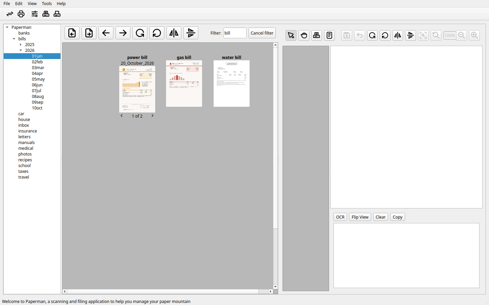
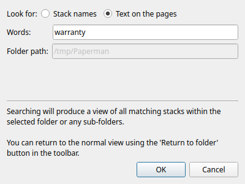
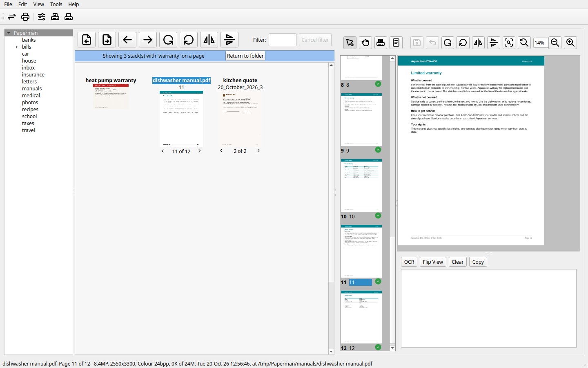

Finding
=======

Paperman finds stacks by their names and by the words on their pages.

The filter
----------

To pick a stack out of a busy folder, type part of its name in the
**Filter** box above the stack pane. Only the stacks whose names have
those letters in them are shown; **Cancel filter** shows them all again.

Searching
---------

**Edit > Search** (Ctrl+S), or **Search folder** in a folder's right-click
menu, searches the folder chosen and every folder inside it.

Look for **Stack names** to find stacks by name, where part of a name is
enough, or **Text on the pages** to find them by the words on their
pages. When looking for words, the last one may be the start of a word,
so *warr* finds *warranty*.

The stack pane then shows the stacks found, from whichever folders they
are in, with a bar saying what was looked for. Select one to see the page
the words are on in the preview pane.

- **Locate folder** (Ctrl+Shift+L), in a stack's right-click menu, goes
  to the folder the stack is in, with the stack selected.
- **Return to folder** goes back to the folder as it was.

Searching a folder on a server asks the server, which answers as it can:
if it is still reading the text of its stacks, the bar says that some
may be missing.

Reading the text of pages
-------------------------

Searching by words needs the text of the pages, which Paperman reads
from each page's picture (optical character recognition, or OCR) with
``tesseract``; see :doc:`install` for adding it.

- Once a scan is saved, Paperman reads its pages in the background. The
  option **Read the text of scanned pages (OCR)** in **File > Options**
  turns this off.
- **Read text (OCR)**, in a stack's right-click menu, reads stacks scanned
  before, or with the option off.
- The text pane shows the text read from the page shown, and its **OCR**
  button reads that page again (see :doc:`desktop`).
- The PDFs Paperman makes keep the text, so other programs can search
  them and the text can be copied from them.

A server reads the stacks it holds itself, when it is run with
``--read-pages`` (see :doc:`server`). From the command line,
``paperman --ocr`` reads every stack in a folder and ``paperman
--search`` searches what has been read (see :doc:`cli`).
