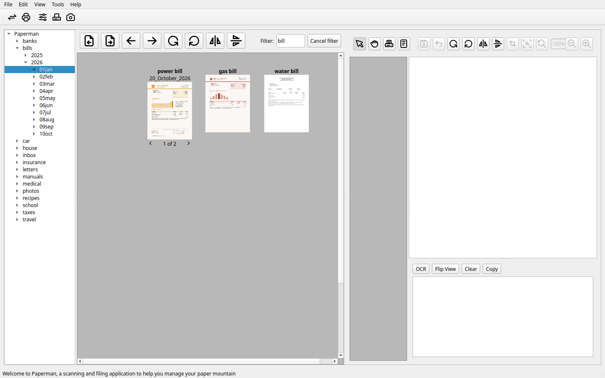
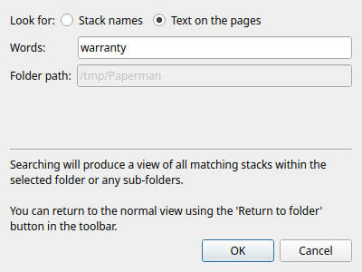
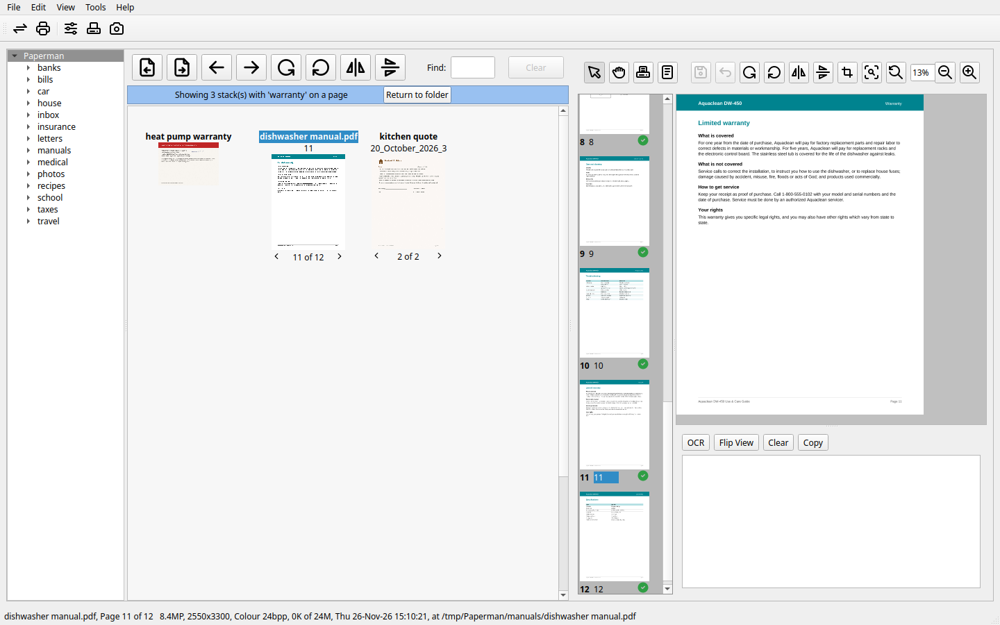

Finding
=======

Paperman finds stacks by their names and by the words on their pages.

The filter
----------

To pick a stack out of a busy folder, type part of its name in the
**Filter** box above the stack pane. Only the stacks whose names have
those letters in them are shown; **Cancel filter** shows them all again.

Searching
---------

**Edit > Search** (Ctrl+S), or **Search folder** in a folder's right-click
menu, searches the folder chosen and every folder inside it.

Look for **Stack names** to find stacks by name, where part of a name is
enough, or **Text on the pages** to find them by the words on their
pages. When looking for words, the last one may be the start of a word,
so *warr* finds *warranty*.

The stack pane then shows the stacks found, from whichever folders they
are in, with a bar saying what was looked for. When looking for words,
the stacks with all of them are shown, best first, each turned to the
page which matches best: select one to see that page in the preview
pane. Words typed into a stack's notes (with the page toolbar's
information tool) are found too.

- **Locate folder** (Ctrl+Shift+L), in a stack's right-click menu, goes
  to the folder the stack is in, with the stack selected.
- **Return to folder** goes back to the folder as it was.

Searching for words uses an index of them, kept in ``.paperindex`` at
the top of the repository and brought up to date each time you search.
After an upgrade which finds text an older Paperman did not, the index
is built again the first time you search, which takes a while in a large
repository.

A folder on a server is searched by the server, which must be run with
``--index`` (see :doc:`server`). While it is still building its index,
the bar says that some stacks may be missing.

Reading the text of pages
-------------------------

Searching by words needs the text of the pages, which Paperman reads
from each page's picture (optical character recognition, or OCR) with
``tesseract``; see :doc:`install` for adding it.

- Once a scan is saved, Paperman reads its pages in the background. The
  option **Read the text of scanned pages (OCR)** in **File > Options**
  turns this off.
- Reading takes longer than scanning: a second or so for a page, with
  several pages read at a time. Paperman reads half as many at once as
  the computer has processors, up to sixteen, unless **Pages read at
  once** in **File > Options** says otherwise. While there are pages
  left, the status bar says how many, such as *Reading text: 1,204 pages
  in 3 stacks*.
  Paperman can be used as usual meanwhile, and a stack still to be read
  can be renamed, moved or have its folder refreshed.
- Click that, or choose **Tools > Background work**, to see the stacks
  waiting, in the order they are read. **Pause** holds the reading back
  while the computer is wanted for something else; **Remove from list**
  drops the stacks selected; **Stop reading** drops them all. Pages
  already read keep their text, and **Read text (OCR)** reads the rest
  of a stack another time.
- Quitting with pages left asks first. The stacks are not forgotten:
  Paperman carries on with them, from where it stopped, shortly after it
  next starts.
- Each page keeps its words, with where each one is, in the stack's
  ``.max`` file, so they go with the page when it is stacked, unstacked
  or copied. Turning a page drops its text, which is then read again the
  right way up.
- **Read text (OCR)**, in a stack's right-click menu, reads stacks scanned
  before, or with the option off.
- The text pane shows the text read from the page shown, and its **OCR**
  button reads that page again (see :doc:`desktop`).
- The PDFs Paperman makes keep the text, so other programs can search
  them and the text can be copied from them.

A server reads the stacks it holds itself, when it is run with
``--read-pages`` (see :doc:`server`); **Read text (OCR)** on a stack
there asks the server to read it next. From the command line,
``paperman --ocr`` reads every stack in a folder and ``paperman
--search`` searches what has been read (see :doc:`cli`).
