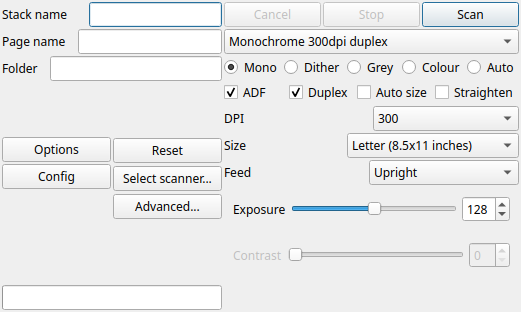

Getting Started
===============

Paperman keeps your papers in ordinary folders on your computer, much as
a filing cabinet keeps them in drawers and hanging files:

Repository
   A folder which holds your papers, with folders inside it for each
   kind, such as bills, taxes and the house. You can have more than one.

Stack
   One document: a bill, a letter, a manual. A stack scanned with
   Paperman is a ``.max`` file; PDFs and JPEGs can sit beside them and
   are shown in the same way.

Page
   One side of one sheet of a stack. Paperman keeps the words read from
   each page with it, so that a stack can be found by what it says.

Installing
----------

Paperman runs on Linux, Windows and macOS. See :doc:`install` for each.

The first time it starts, Paperman offers to keep your papers in a
folder called ``Paperman`` in your Documents folder. Say yes, or no to
choose your own: **File > Add repository** adds a repository at any time,
and an existing folder of papers, or of PaperPort ``.max`` files, can be
added just as well.

The window
----------

The **Folder pane** on the left shows your folders, the **Stack pane** in
the middle shows the stacks in the folder chosen, and the **Preview
pane** on the right shows the stack selected: its pages, the page itself
and the text read from it.

.. image:: images/desktop-labelled.png
   :alt: The Paperman window, with each part labelled
   :target: _images/desktop-labelled.png

:doc:`desktop` explains each part.

Scanning your first stack
-------------------------

Put the sheets in the scanner's feeder, then press **F6** (or the scan
button at the right of the toolbar) to open the scan panel beside the
window. The first time, Paperman asks which scanner to use.

#. Choose a **preset**. *Monochrome 300dpi duplex* suits most letters
   and bills: it scans both sides of each sheet. To have the blank backs
   left out, say so under **Options** (see :doc:`scanning`).

#. Give the stack a **name**, such as *power bill*. Leave it empty and
   the stack is named for the day.

#. Choose the **folder** to put it in, by typing part of its name.

#. Press **Scan**. The pages appear as they come through the scanner.

Once a scan is done, Paperman reads the text of its pages in the
background, so that the stack can be found by any word on it. This needs
``tesseract``, which :doc:`install` explains how to add.

The scan panel has many more settings, for colour, paper size and more;
see :doc:`scanning`.

Filing by year and month
------------------------

Many people keep bills and other post in a folder for each month, inside
one for each year, such as ``bills/2026/10oct``. Paperman knows this
pattern: name the month folders ``01jan`` to ``12dec`` and

- the scan panel's folder list puts this month's folder first, so typing
  *bills* is enough to scan into it,
- when only last month's folder is there, it offers to make this
  month's, and
- **View > Filter year/month** (Ctrl+Shift+F) shows only this year's and
  this month's folders in the folder list.

.. image:: images/scan-folders.png
   :alt: The scan panel suggesting folders, this month's first

Next steps
----------

- :doc:`desktop`: finding your way around the window
- :doc:`scanning`: everything the scan panel can do
- :doc:`server` and :doc:`app`: reaching your papers from other
  computers and from your phone
