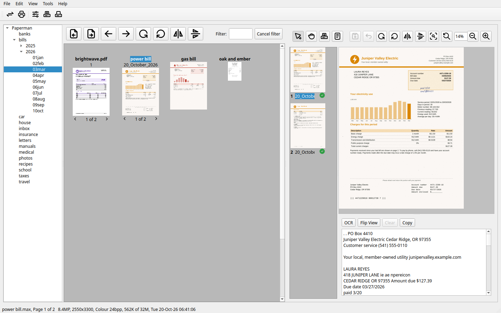

Introduction
============

Paperman is an electronic filing cabinet: it scans paper into stacks of
pages, and lets you view, arrange, annotate, print, search and send them.
It reads and writes PDF, JPEG and its own variant of PaperPort's .max file
format.

Paperman's website, `getpaperman.com <https://getpaperman.com>`__, has an
overview of what it does and the downloads for each platform.

Paperman has three parts:

The desktop program
   for scanning, filing and working with papers, on Linux, Windows and
   macOS (see :doc:`install` and :doc:`scanning`)

The search server, ``paperman-server``
   which serves repositories over the network, with a REST API, so that
   they can be reached from elsewhere: the desktop program shows a
   server's repositories beside its own and can change them, and the
   apps browse them (see :doc:`server` and :doc:`api`)

The Android and iPhone app
   for finding and reading papers from a phone or tablet, from a
   server's repositories, with a full-text search and each document
   shown as a PDF (see :doc:`app`)

So papers can be scanned at a desk, kept on one machine running the
server, and found from anywhere.

New to Paperman? Start with :doc:`getting-started`.

Features
--------

- Simple GUI based around stacks and pages
- View previews and browse through pages
- Move pages in and out of stacks
- Navigate through directories
- Move stacks between directories
- Print stacks and pages, including page annotations
- Full undo/redo
- Scanning from sheet-fed scanners, fast, with presets (see :doc:`scanning`):

  - pages cut to the sheet, and straightened, by the scanner
  - pages without colour stored as grey or mono, while a page with a
    coloured mark or note on it stays in colour
  - blank pages found and left out
  - sheets fed sideways turned upright, and sheets longer than any paper
    size scanned whole
  - a misfeed or jam waits to be cleared, and loses no pages
  - scanning from the command line (see :doc:`cli`)

- PDF, JPEG and TIFF conversion
- Unfolding scanned booklets into their pages
- OCR with full-text search: scanned pages are read in the background
  (tesseract), each page's text is shown beside it, stacks can be found by
  the words on their pages, and the PDFs Paperman makes can be searched
  and their text copied (see :doc:`finding`)
- Search server with REST API, whose repositories the desktop can show and
  change, with changes made elsewhere shown as they happen (see
  :doc:`server`)
- Android and iPhone app for browsing, searching and reading a server's
  repositories, with an offline demo mode (see :doc:`app`)
- Email files as PDF with your mail program or Gmail (see :doc:`sharing`)
- Linux, Windows (x64 and Arm) and macOS
