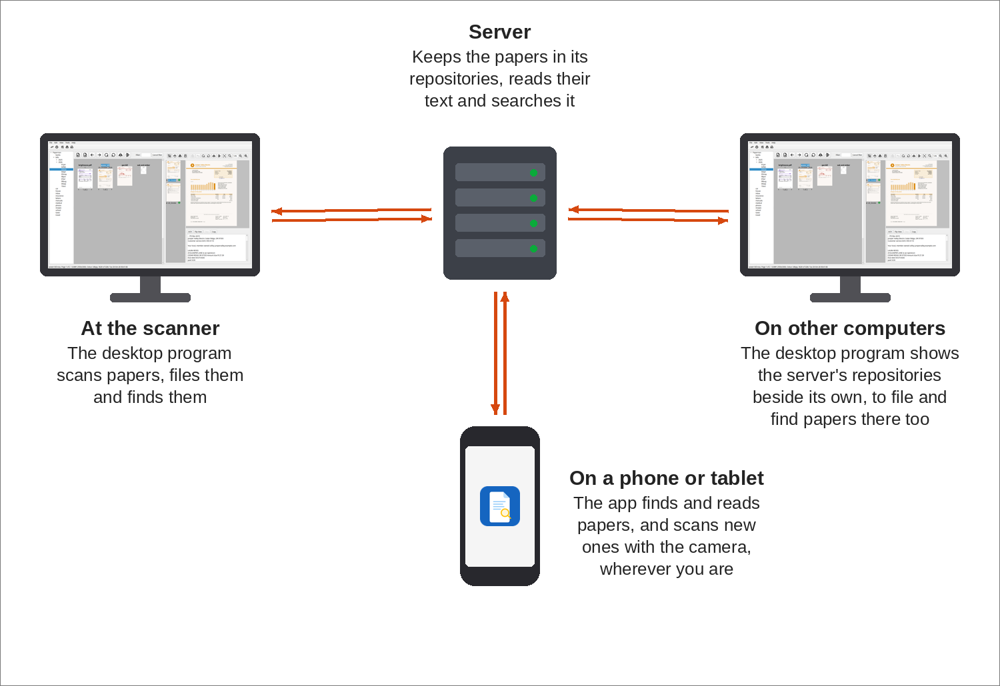
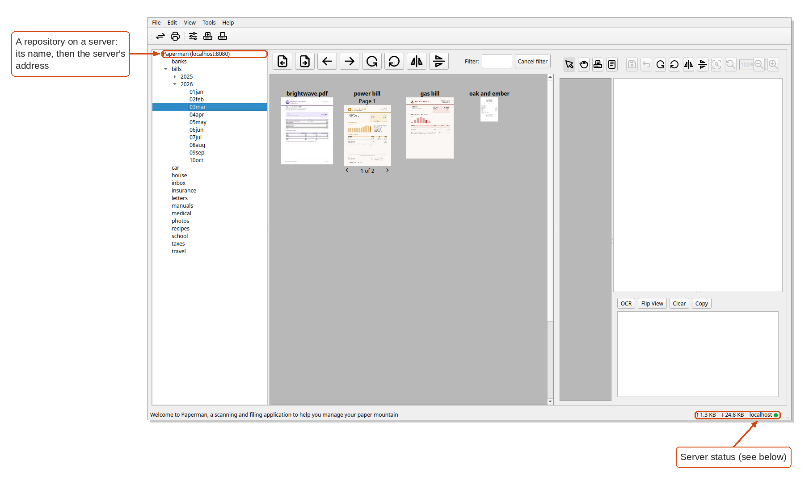

Working across machines
=======================

Papers kept on one computer can be reached from others, and from a
phone, by putting them on a Paperman server.

- The **server**, ``paperman-server``, keeps one or more repositories of
  papers. It can read the text of their pages and search it, so that
  each computer need not.
- The **desktop program**, at the scanner or on any other computer,
  shows the server's repositories in its folder pane beside its own.
  Their stacks can be filed, found, printed and scanned into as if they
  were on the computer itself.
- The **app**, on an Android phone or an iPhone, finds and reads the
  papers on the server and scans new ones with the phone's camera (see
  :doc:`app`).

A single computer needs no server: the desktop program works on its own
repositories without one.

Setting up a server
-------------------

Run the server on a computer which is always on, giving it the folder of
papers to serve:

.. code:: bash

   paperman-server --index --read-pages 4 /home/user/Documents/papers

``--index`` lets the desktop and the app search the text on the pages,
and ``--read-pages`` reads the pages of every stack in the background,
here four stacks at a time. Add a user for each person, which asks for
their password:

.. code:: bash

   paperman-server useradd alice

See :doc:`server` for building it and its options, and :doc:`systemd`
for running it as a service. To reach it from outside your own network,
put it behind a web server with HTTPS (see :doc:`deployment`).

Connecting the desktop
----------------------

The desktop program attaches each server listed in
``~/.config/paperman/client.conf`` when it starts. Add a server with:

.. code:: bash

   paperman-client add-server papers.local

Given only a host, as here, Paperman looks for the server on its usual
ports and stores the address it finds. To attach a server just once,
start the desktop program with ``paperman --server papers.local``. When
the server has users, Paperman asks for a user and password the first
time and remembers the login. See `Connecting Clients
<server.html#connecting-clients>`_ for more.

A server which cannot be reached when the desktop starts is reported
once, and the desktop carries on without it.

Each repository on the server then appears in the folder pane, named
with the server's address after it:

Server status
~~~~~~~~~~~~~

While a folder on a server is shown, the right of the status bar shows
the server status, from left to right:

- **⇅**, only while waiting for the server: how many requests are
  waiting, how much is still to come, and how long it has waited, once
  that is more than a few seconds
- **↑**: how much has been sent to the server
- **↓**: how much has been received from it
- the server's host name
- a light: **green** when all is quiet, **amber** while waiting for the
  server, and **red** when the server is not answering, or the news of
  changes made by others has stopped arriving

Click it for the details, kept up to date while open.

Working with a server
---------------------

A folder on a server works like one on the computer:

- **Filing:** stacks can be moved, stacked, renamed and deleted as
  usual (see :doc:`filing`). The server makes each change, and other
  desktops showing the same folder see it straight away.
- **Scanning:** choose a folder on the server in the scan panel, and the
  scan is sent to the server once it is saved (see :doc:`scanning`).
- **Finding:** searching a folder on the server is done by the server,
  which must be run with ``--index`` (see :doc:`finding`). **Read text
  (OCR)** asks the server to read the stack next.
- **Sharing:** printing, emailing and copying fetch the stacks first
  (see :doc:`sharing`).

The pages of a stack are fetched as they are shown, and kept, so a stack
opens quickly the next time.
