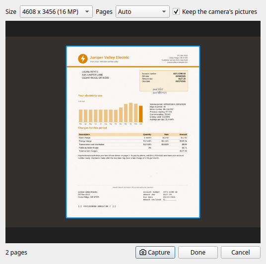

Scanning
========

Paperman scans straight into a stack: pages appear in the window as the
scanner delivers them, and the stack is saved in the folder chosen for
it. It is written for sheet-fed document scanners, such as the Ricoh
(formerly Fujitsu) fi-series, but any scanner the platform can drive will
do.

What will not go through a scanner, such as a bound book, can be
photographed a page at a time instead: see `Scanning with a camera`_.

Scanners on each platform
-------------------------

Linux
   Scanners are reached through `SANE <http://www.sane-project.org>`_,
   using its back end for the scanner. Install ``sane-utils`` and check
   that ``scanimage -L`` lists the scanner.

Windows
   Scanners are reached through their TWAIN driver: every TWAIN data
   source installed on the machine appears in the scanner list. Paperman
   is a 64-bit program, so it needs the 64-bit driver; for the fi-series
   that is **PaperStream IP (TWAIN x64)**, a separate download from the
   32-bit PaperStream IP (TWAIN) on Ricoh's site. After installing it,
   sign out and in again (or restart) before looking for the scanner:
   PaperStream sets the scanner up for TWAIN when the user logs in, and
   until then no scanner is listed.

macOS
   Scanners are reached through SANE, as on Linux, from Homebrew's
   ``sane-backends``. Some recent scanners are not yet known to the SANE
   release Homebrew has, in which case a newer SANE, built from source,
   is needed.

The first time Scan is pressed, Paperman asks which scanner to use, and
remembers it after that. **Select scanner...** in the scan panel picks
another.

The scan panel
--------------

Pressing the scan button in the toolbar opens the scan panel beside the
window.

Stack name, Page name and Folder
   What to call the new stack and its pages, and where to put it. Type in
   the Folder field (Ctrl-F or F4 reaches it) to find or create a folder:
   folders named by year and month, such as ``2026/09sep``, are matched as
   you type, and Enter scans straight into the match.

Presets
   Keep a set of scan settings under a name: the mode, DPI and duplex,
   and also the size, feed, Auto size, Straighten, brightness and
   contrast. Ctrl-1 to Ctrl-5 select the first five. The list names the
   preset the panel matches, or shows ``<custom>`` when it matches none.

   To change a preset, choose it, set the panel as wanted and pick
   **Update '<name>'** from the list; **Rename preset...** gives it
   another name and **Delete preset...** removes it. **Add preset...**
   keeps the panel's settings as a new one. The standard presets, and any
   kept by an earlier Paperman, have only the mode, DPI and duplex: for
   the rest they give the usual paper size, fed upright, with Auto size
   and Straighten off and the brightness and contrast in the middle.

Mono, Dither, Grey, Colour and Auto
   The kind of image to scan. **Auto** scans in colour and stores each
   page with no colour on it as grey, and one with no shading either as
   mono, so that a stack of letters takes little space while a page with
   a coloured logo, a photo or a note in coloured pen stays in colour. On
   a first run the panel starts with the **Auto 200dpi duplex** preset.

ADF and Duplex
   Feed sheets from the document feeder, and scan both sides of each.

Auto size
   Let the scanner find the size of each sheet and end the page at its
   foot. With this on, the size chosen is the most a page can be, and is
   shown as **Max size**.

Straighten
   Have the scanner straighten each sheet and cut the page down to it,
   corners and all. Sheets go through more slowly, since the scanner
   reads each one in full before passing it on.

DPI
   300 gives a good scan; 200 is fax quality.

Size
   The paper size. Alt-A selects A4 and Alt-L toggles US Letter and
   Legal. **Full size** is as wide as the scanner takes, and on a sheet
   feeder as long as the longest paper size it takes. While the scanner
   is cutting pages to the sheet (Auto size or Straighten), there is
   also a **Long** size, as wide and as long as the scanner will take,
   for sheets longer than any paper size, such as till receipts.

Feed
   Sheets fed sideways (**Top at left** or **Top at right**) are scanned
   the long way across the scanner and turned upright as they are stored.
   The size chosen describes the page, and the whole page is scanned.
   **Full size** and **Long** describe the scanner instead, so each is
   the same window whichever way the sheets are fed: Long takes a long
   sheet fed sideways, such as a banner printed along its length.

While a scan runs
-----------------

The panel shows each page's coverage, how many pages have come and how
fast (pages per second over the last ten seconds).

- **Stop** stops after the page being scanned. Sheets which the scanner
  has already taken in are still scanned and kept.
- **Cancel** abandons the scan.
- If the feeder misfeeds or jams, Paperman says so and waits: clear it,
  put the sheets back and press **Scan** to carry on into the same stack.
  A page cut short by a jam is kept at the length that was scanned.

Blank pages
   The Options dialog says what to do with a blank page: record it,
   leave it out if it is the back of a sheet, or leave it out wherever it
   is.

Scanning with a camera
----------------------

A document camera, which looks down on a page from a stand, scans what
will not go through a feeder: a bound book, a fragile letter, something
too big or too thick. Paperman takes a picture each time a key is
pressed and keeps the pages in it as one stack, so a book is scanned by
turning a page and pressing a key, over and over.

Cameras are reached through the kernel's video interface, on Linux only
for now. Any UVC camera which sends its pictures as JPEG will do, which
covers most document cameras and webcams.

Lay the page on a dark mat, so that Paperman can tell where it ends.
Paperman finds the page in each picture, cuts it out and makes it
upright, and splits an open book into its two pages. Pages which curve,
as those of a thick book do, are made flat.

Press |main-camera| in the main toolbar, or **F7**, to open the camera
panel. The button is greyed out when no camera is plugged in.

         it will be cut out, and two pages taken

Camera
   Which camera to use. This is shown only when there is more than one.

Size
   The size of each page, in pixels, with the largest the camera can
   take first. A larger size shows finer print, and at the largest a
   camera may take a second or so over each page.

Pages
   What to keep of each picture.

   **Whole picture** keeps it just as the camera sent it, mat and all.

   **One page** finds the sheet, cuts it out and makes it upright. A
   sheet which lies crooked, or which the camera sees from one side so
   that it is narrower at the far end, comes out square.

   **Two pages** does the same for an open book and then cuts it in two
   down the gutter, the left page going into the stack before the right.
   If no gutter can be seen it is cut down the middle.

   **Auto**, which the panel starts with, treats what it sees as a book
   if it is wider than it is tall and has a clear gutter, and as one
   page if not.

   Where no page can be found, as when the mat is as light as the paper
   or the page fills the picture, the whole picture is kept.

   The pages of an open book curve up from the gutter. Paperman follows
   the top and bottom edges of each page across the picture and makes
   the page flat from them: its lines come out level, and the part which
   slopes down into the gutter, which the camera sees squeezed, is
   stretched back to its width. What lies beside the page, such as the
   flap of a jacket or the edges of the pages beneath, is left out where
   it can be told from the page. This needs both edges of the page to be
   seen against the mat for at least part of the way across. A page
   which runs off the picture at one edge is still made flat, with the
   part the camera missed left white, but one which runs off it at both
   is only trimmed and split at the gutter, as is one whose edges
   Paperman cannot follow. A page which curves only a little is treated
   as a flat sheet.

Keep the camera's pictures
   Keep each picture as the camera sent it, as well as the pages cut
   from it, so that a page which came out badly can be made again. They
   go in a second stack, named after the first with ``_camera`` added,
   which appears beside it when Done is pressed. This is not done for a
   folder on a server, nor when Pages is Whole picture, since the
   picture is then the page.

Camera's view
   What the camera sees, several times a second, so that the page can be
   put straight and the light checked before it is taken. Each page
   which would be cut out is outlined in blue, along its own edges if it
   curves and will be made flat. It is a small picture:
   the page taken is much sharper.

Page count
   How many pages are in the stack so far. Cutting the pages out of a
   large picture takes a second or so, which is done in the background:
   the next picture can be taken at once, and the count goes up as the
   pages arrive. Beside it is how many pictures are still being worked
   on, or any problem with the camera.

Capture
   Take a picture and add it to the stack as its next page. The space
   bar does the same from anywhere in the panel, so one hand can stay on
   the book. The button shows **Capturing...** until the page arrives,
   and pressing again before then does nothing.

The camera's own button
   Some cameras have a button, on a lead or a pedal, which has the
   camera take the page itself and send the picture. While the panel is
   open, each such picture is added to the stack just as one taken with
   Capture is, at the size the camera sends it, which may not be the
   Size chosen. A camera whose button sends nothing does nothing here.

Done
   Keep the stack and close the panel. Closing the panel with Escape, or
   with its window's close button, does the same. If pictures are still
   being worked on the panel says how many and closes once their pages
   are in the stack.

Cancel
   Throw away the pages taken, and the camera's pictures if they are
   being kept, and close the panel.

The stack is made in the folder shown in the main window when the first
page is taken, and its pages appear in the page view as they are taken.
The stack and its pages are named as the scan panel has them, or for the
day if it has no names. With nothing taken, Done and Cancel leave no
stack.

A camera cannot tell how far it is from the page, so it does not know
the page's resolution: each page is recorded as 300 dpi. To record
another, set ``dpi`` in the ``[camera]`` section of Paperman's settings
file, ``~/.config/paperman/paperman.conf``. If the first picture a
camera takes after a pause comes out dark, set ``skip_frames`` there to
1 or 2, to have Paperman pass over that many before it keeps one. The
pages cut out of a picture are stored as JPEG at a quality of 90, which
``quality`` there changes.

How far a curved page must be stretched to make it flat depends on how
far the camera is from it, which shows in the focal length of the
camera's lens. Paperman takes that to be 0.7 times the width of the
picture, a figure found by trying it with one camera. If the words near
the gutter of a book come out wider than the rest, set ``focal`` in the
same section to a smaller number, and if narrower to a larger one.

Scanning without the window
---------------------------

``paperman --scan`` scans from the command line with the same settings;
see :doc:`cli`.

When something goes wrong
-------------------------

``--log FILE`` writes everything Paperman would say on the terminal to a
file, including the dialogs it shows, and turns on diagnostics which a
normal run keeps quiet. With ``--sane-debug LEVEL`` the scanner back end
logs its commands too (15 shows every command and what the scanner
answered). A log from a scan which went wrong is the best thing to send
with a report.

Some environment variables help too:

``PAPERMAN_SCAN_STATS=1``
   Print statistics at the end of each scan, in the window as well as with
   ``--scan``: sides scanned, time per side, CPU used by the display and
   scanning threads, and how far the display fell behind the scanner. The
   first thing to look at if scanning seems slow.

``PAPERMAN_TWAIN_DEBUG=1`` (Windows)
   Log every TWAIN operation and the capabilities the driver reports.

``PAPERMAN_TWAIN_RGB=1`` (Windows)
   For a driver which swaps red and blue.

``PAPERMAN_TWAIN_DUMP=<file>`` (Windows)
   Write the first scanned image as a PBM, PGM or PPM, exactly as the back
   end hands it to Paperman, which separates driver problems from filing
   problems.

``PAPERMAN_TWAIN_LEGACY=1`` (Windows)
   Use the ``twain_32.dll`` shipped with Windows rather than the TWAIN 2
   data source manager, ``TWAINDSM.dll``, installed with any current driver.

A fake scanner
--------------

On Linux, ``paperman --fake-scanner DIR`` offers a fake Fujitsu
scanner beside the real ones, fed from pictures dropped into
``DIR/hopper``. It is used by the tests and is handy for trying things
without paper; see :doc:`testing`.

