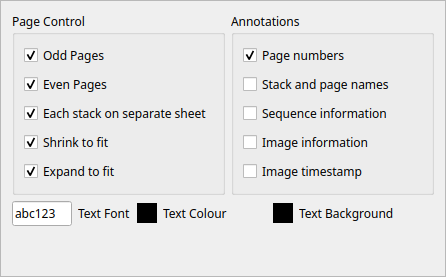
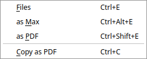
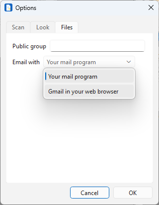
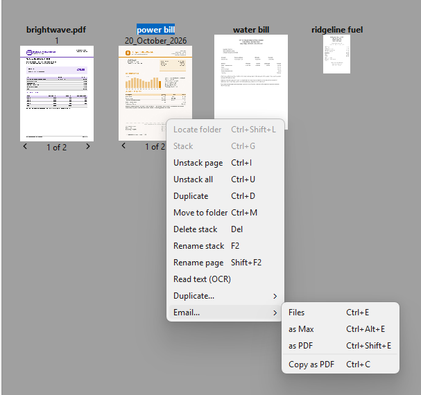
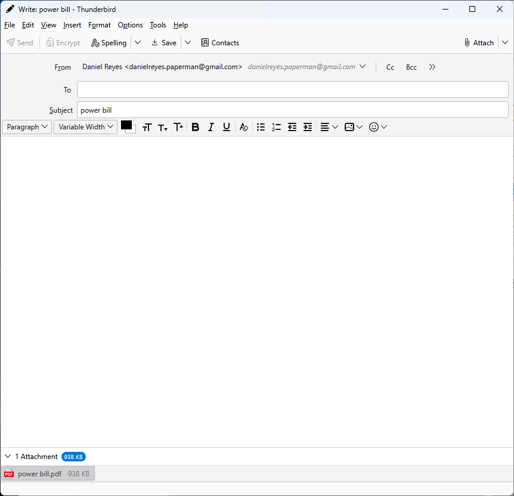
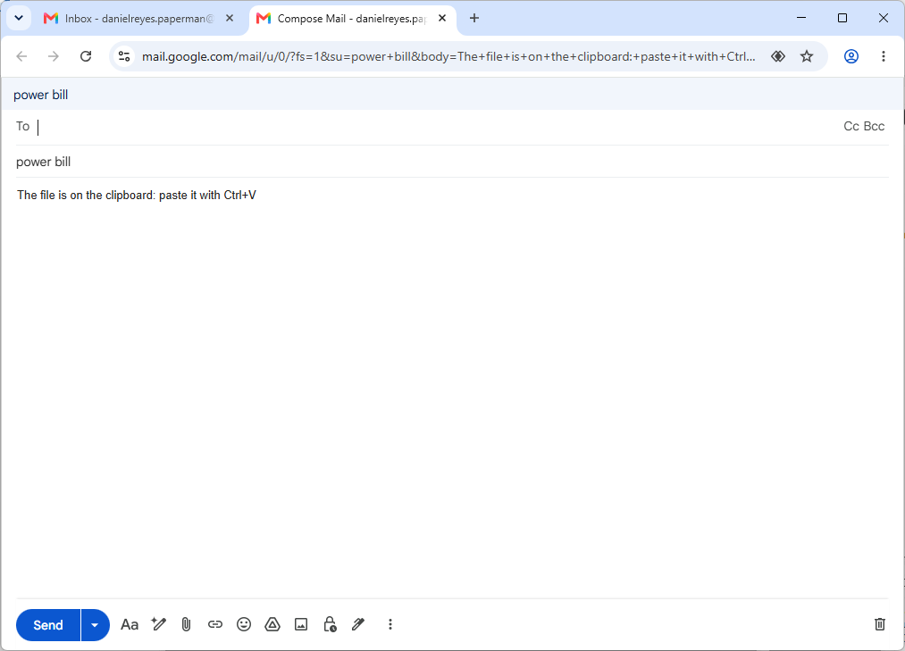
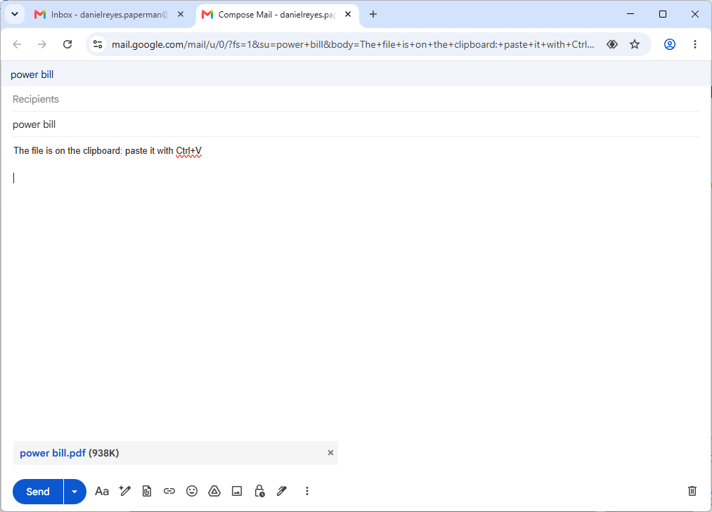

Sharing
=======

Papers kept in Paperman can be printed, emailed, copied to other programs
and saved as PDFs or pictures.

Printing
--------

Press **Ctrl+P**, or the print button in the main toolbar. In the
desktop view this prints the stacks selected; in the page view it
prints the page shown. A stack in a folder on a server is fetched first.

The print dialog is your system's own, with a tab of Paperman's options
added:

.. list-table::
   :widths: 35 65

   * - **Odd Pages**, **Even Pages**
     - Which pages to print, for printing both sides by hand: print the
       odd pages, put the paper back in, then the even ones
   * - **Each stack on separate sheet**
     - When printing on both sides, start each stack on a new sheet
   * - **Shrink to fit**, **Expand to fit**
     - Shrink a page which is too big for the paper, or enlarge one
       which is too small
   * - **Page numbers**
     - Print the page number at the bottom right of each page
   * - **Stack and page names**
     - Print the names of the stack and the page
   * - **Sequence information**
     - Print a sequence number for the print job on every page
   * - **Image information**
     - Print the size, resolution and depth of each page's picture
   * - **Image timestamp**
     - Print when each page was scanned
   * - **Text Font**, **Text Colour**, **Text Background**
     - How the printed names and numbers look

Press **Save** in the print dialog to keep these settings for next time.

Emailing
--------

The **Email...** submenu, in a stack's right-click menu, sends the stacks
selected:

.. list-table::
   :widths: 35 65

   * - **Files** (Ctrl+E)
     - Send the stacks as they are kept
   * - **as Max** (Ctrl+Alt+E)
     - Send them as ``.max`` stacks
   * - **as PDF** (Ctrl+Shift+E)
     - Send them as PDFs, which anyone can open
   * - **Copy as PDF** (Ctrl+C)
     - Put them on the clipboard as PDFs, to paste anywhere (see below)

Paperman makes the file, named after the stack, and starts a message
with the stack's name as its subject, for you to address and send. More
than one stack is packed into a single zip file first. The file is put
on the clipboard too, ready to paste into the message if it is not
attached already.

How the message is written is set by **Email with**, in the **Files**
tab of **File > Options**:

- **Your mail program**, at first: the message opens in the mail program
  on your computer, with the file attached.
- **Gmail in your web browser**: the message opens on Gmail's page, and
  you paste the file in.

With your mail program
~~~~~~~~~~~~~~~~~~~~~~

Select the stacks and choose **Email... > as PDF**, or another form:

A new message opens in your mail program, here Thunderbird on Windows,
with the PDF attached:

Which mail program opens depends on the computer:

- On Windows, it is the default mail program, which must take files from
  other programs, as Outlook (classic) and Thunderbird do. The new
  Outlook does not, so with it the message opens without the file:
  click in the message and press **Ctrl+V** to attach it.
- On macOS, it is the one chosen in Mail's settings.
- On Linux, Paperman gives the file to the mail program with
  ``xdg-email``, which can attach it in Thunderbird, Evolution or KMail.
  Other mail programs open the message without the file, to paste in.

With Gmail
~~~~~~~~~~

With **Email with** set to **Gmail in your web browser**, choose
**Email... > as PDF** as before. A new message opens on Gmail's page in
your web browser, saying that the file is on the clipboard:

Click in the message and press **Ctrl+V** (**⌘V** on a Mac). The file
is attached:

Gmail opens in the account your web browser is signed in to first. If
you use more than one, give the one to send from a browser profile of
its own, and use it last: a link from another program opens in the
profile used last.

Pasting the file in works with other webmail too, such as Outlook on the
web or Fastmail, since the clipboard is the only way to attach a file to
a message opened from another program.

Copying
-------

**Copy as PDF** (Ctrl+C) turns the stacks selected into PDFs and puts
them on the clipboard, as emailing does but without opening a message.
Paste them wherever a file is wanted: a message, a file manager or a
chat. More than one stack is packed into a single zip file.

Saving as a PDF or pictures
---------------------------

To keep a stack as a PDF, or its pages as JPEG pictures, beside it in the
same folder, use **Duplicate... > as PDF** (Ctrl+Shift+P) or **as JPEG**
(Ctrl+Shift+J) in the stack's right-click menu (see :doc:`filing`). A
PDF made by Paperman keeps the text read from its pages, so it can be
searched and its text copied.

From the command line, ``paperman -p`` turns a stack into a PDF and
``paperman -j`` into JPEGs (see :doc:`cli`).
